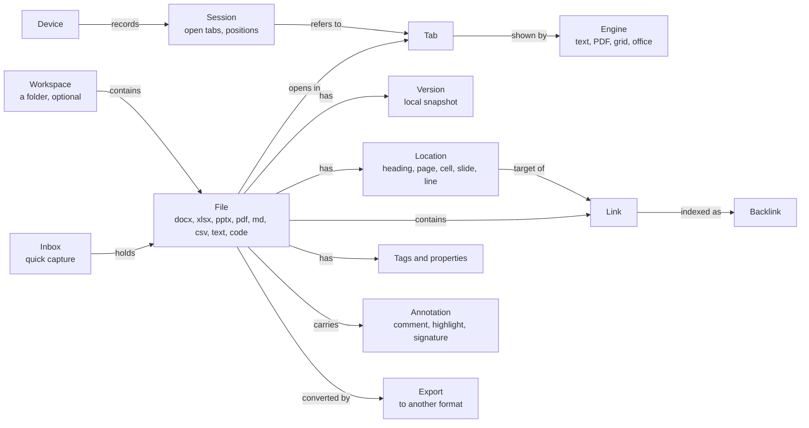
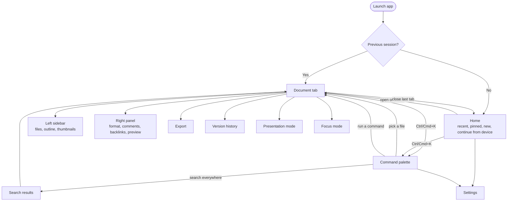
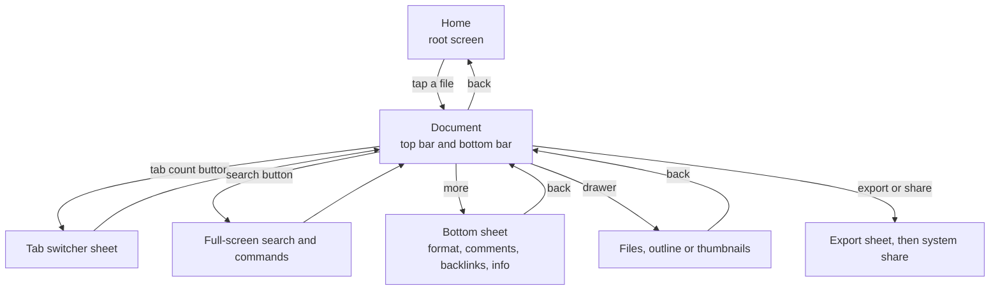

# App map

Two views of the whole product: the things a user works with, and the screens they move between.

## The things in the app

What exists, and how the pieces relate. Every screen and command is about one of these.

## Screens and how they connect

## The same map on a phone

On a phone-width window the screens are the same but stack as layers. Back always closes the top layer.

