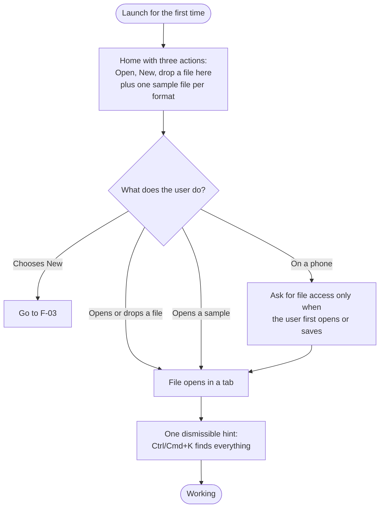
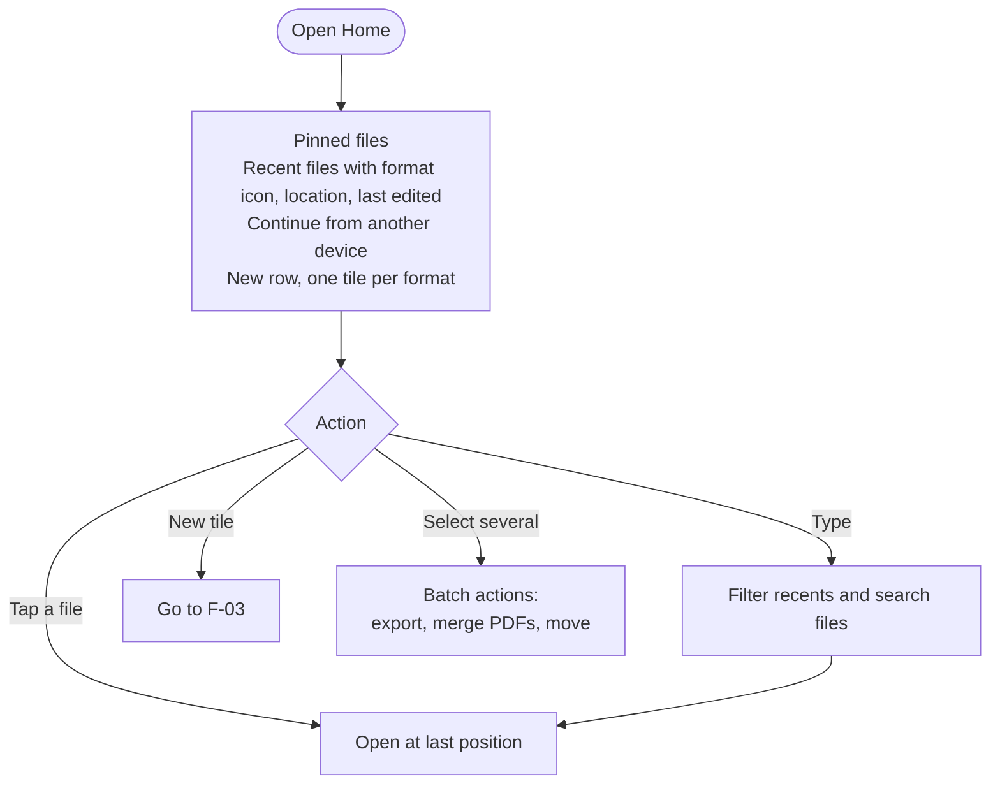
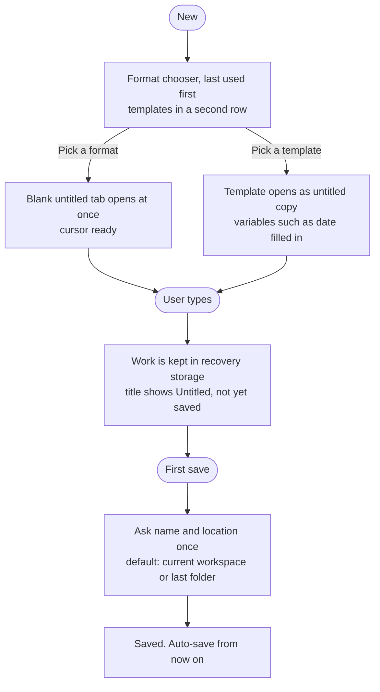
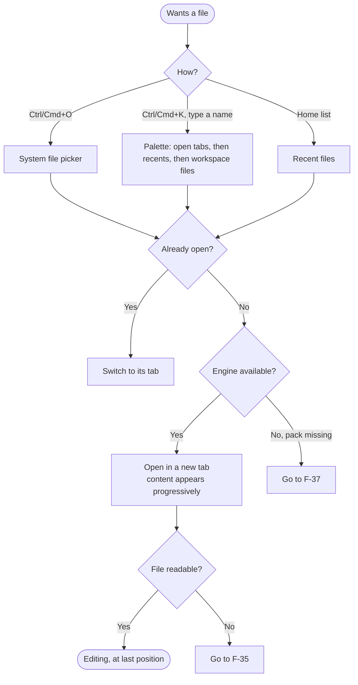
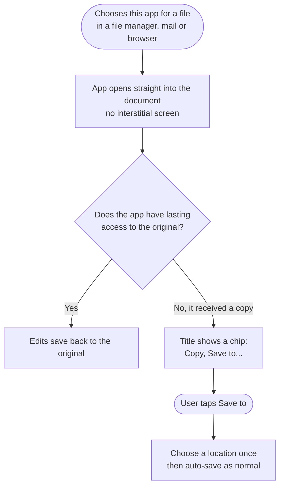

# Starting and opening

## F-01 First launch

No account, no tour. **Step target: 1 action to a working document.**

## F-02 Home

## F-03 New document

Naming and location are deferred to first save. **Step target: 2 actions.**

## F-04 Open with the file picker and F-05 quick open

## F-07 Open from another app

Covers "Open with" on desktop and share-to-app on phones.

