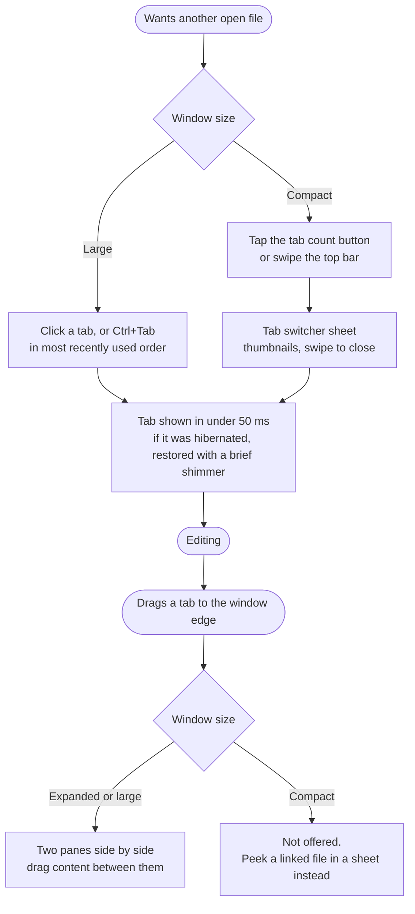
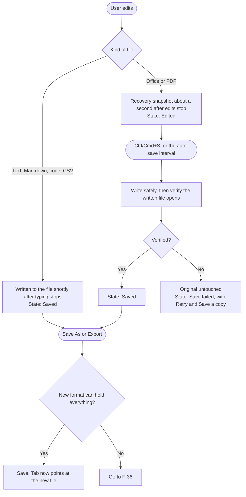
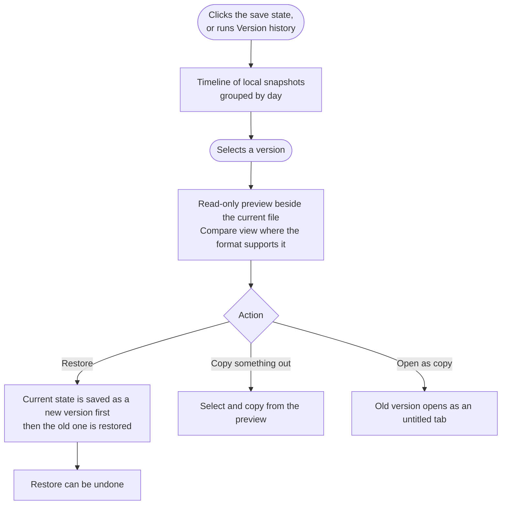
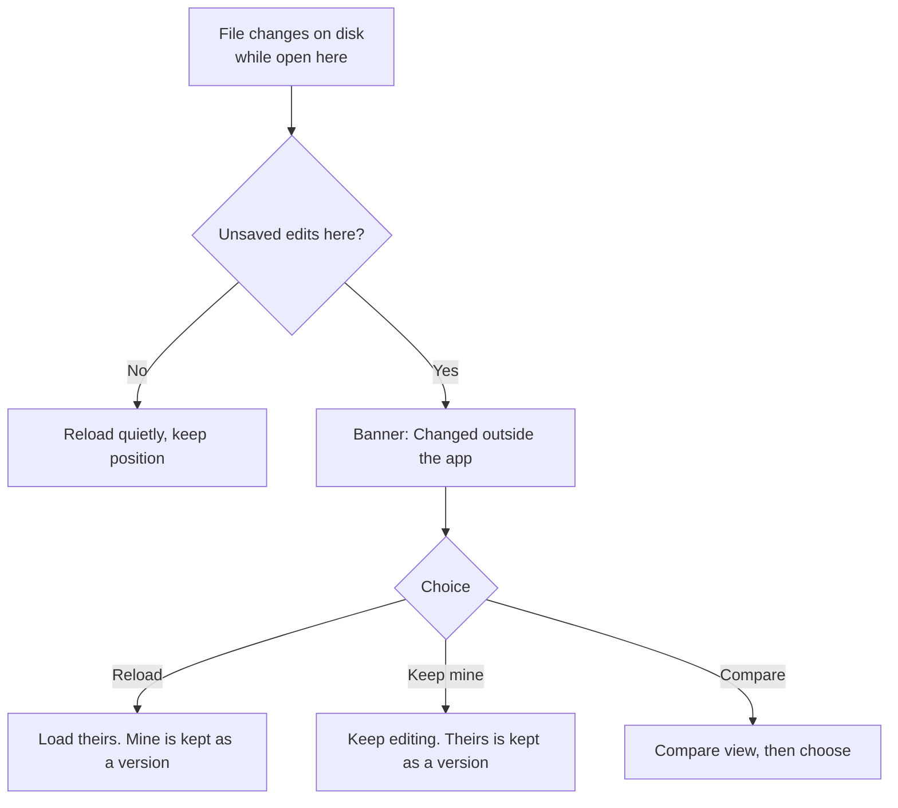
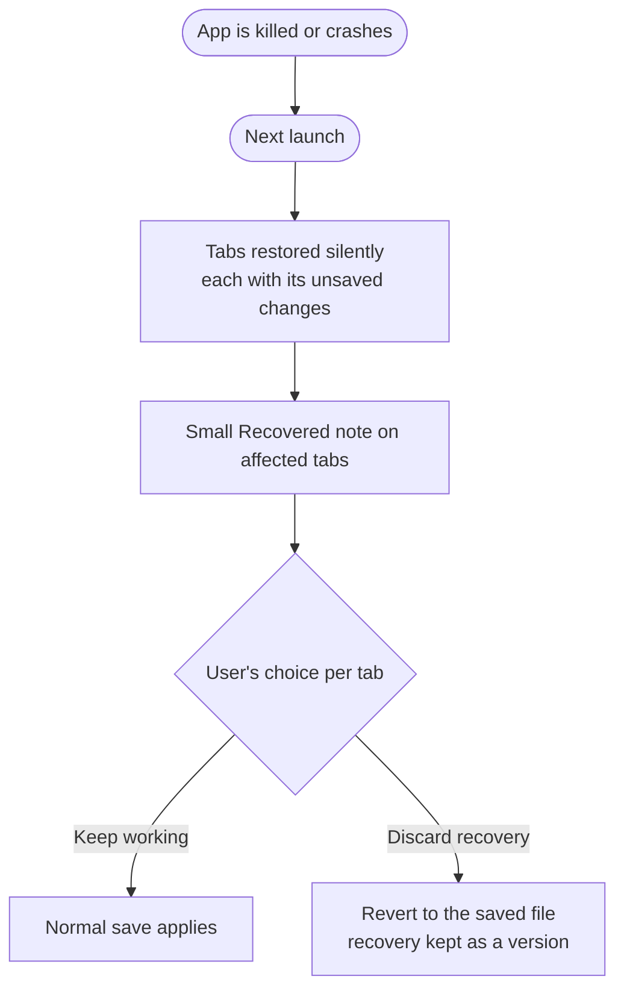

# Tabs, saving and history

## F-08 Switch tab and F-09 split view

## F-11 Save, auto-save, Save As

The save state is always visible in one place. Quitting never asks about saving.

## F-12 Version history and restore

## F-14 File changed outside the app

## F-39 Recovery after a crash

