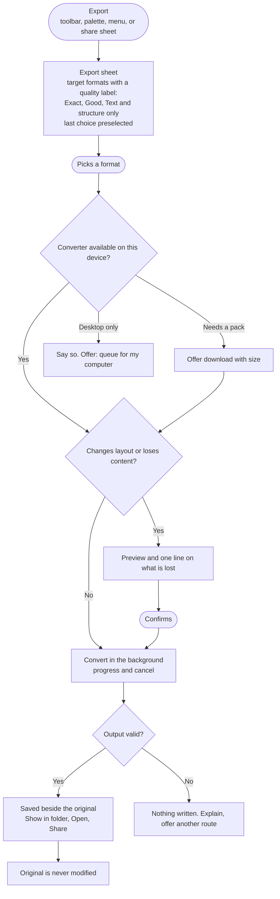
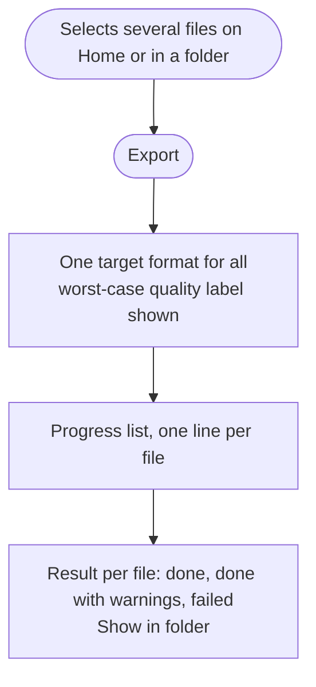
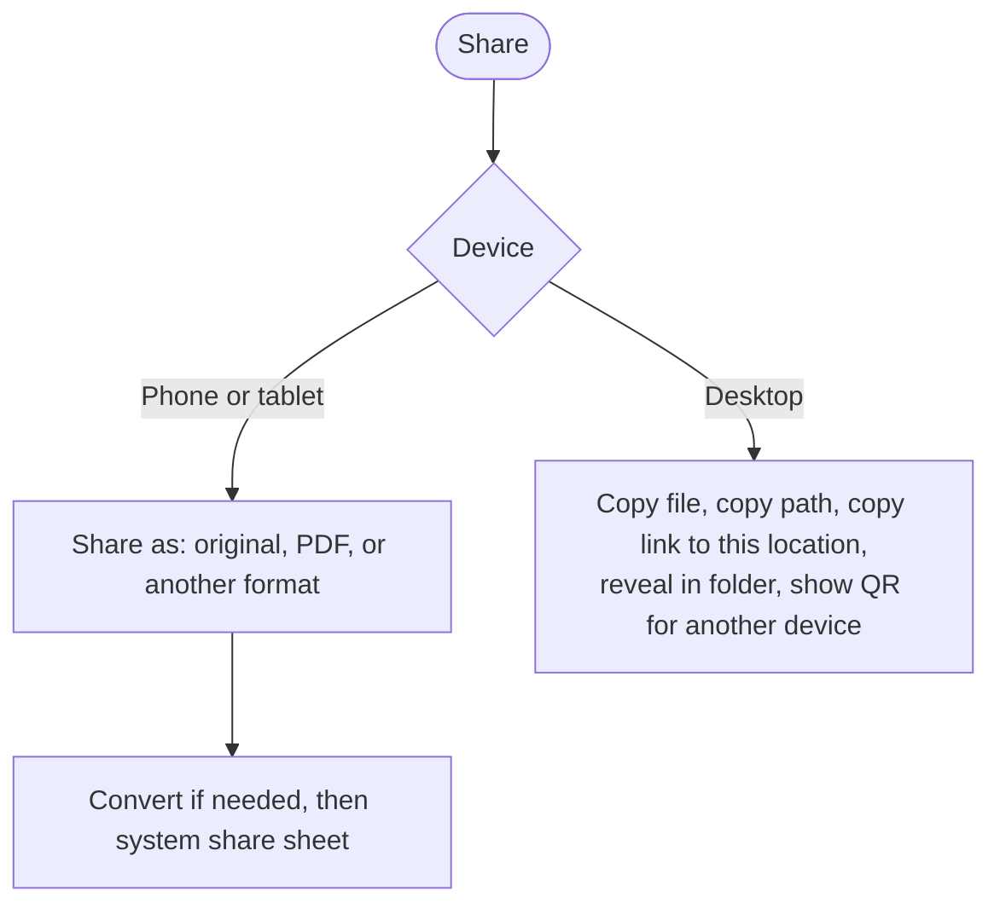
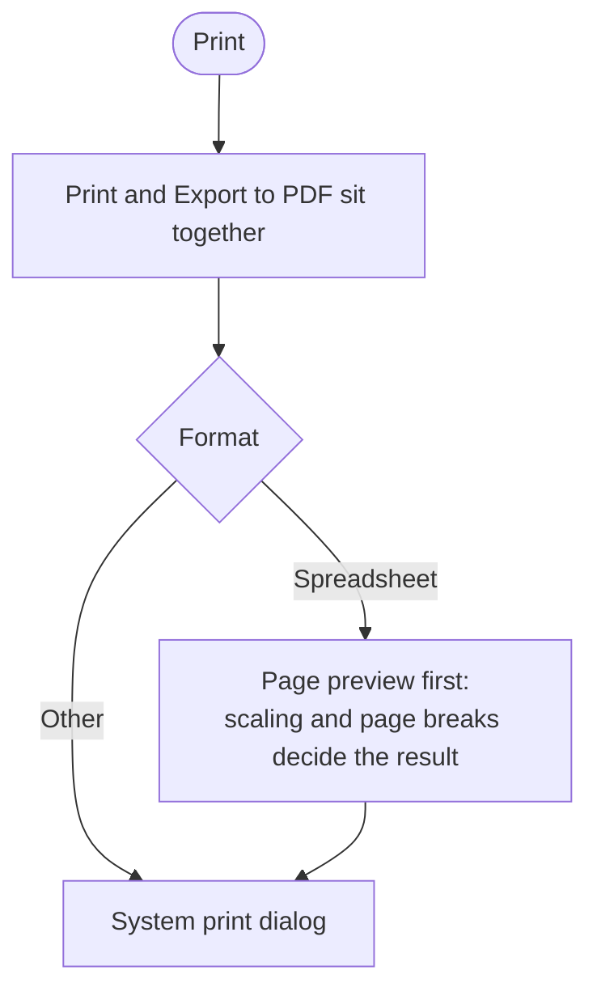

# Export, share and print

## F-15 Export one file

One verb, one sheet, the same in every format. **Step target: 3 actions for a repeat export** (open the sheet, confirm the remembered format, done).

## F-16 Batch export

## F-17 Share

## F-30 Print

