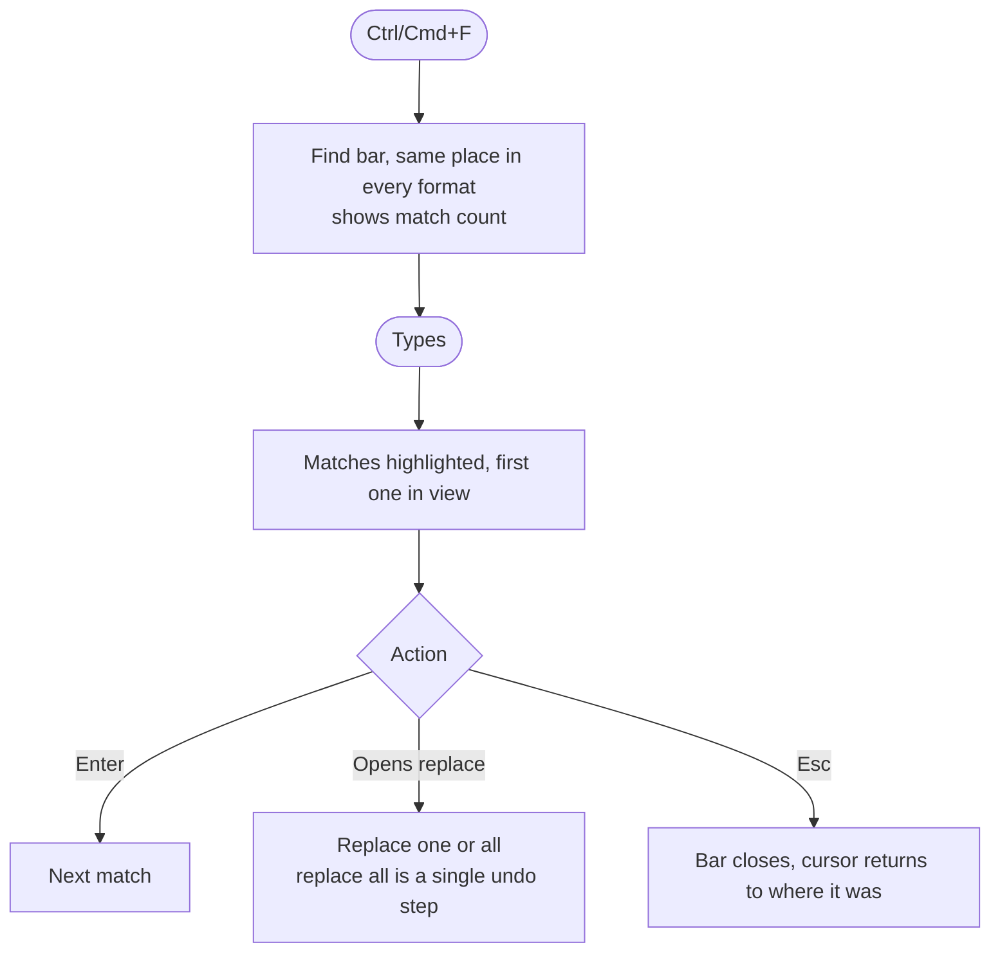
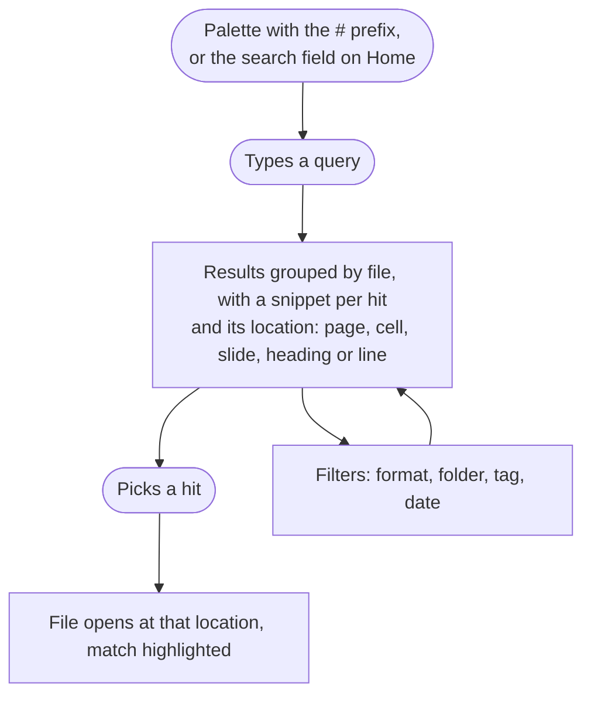
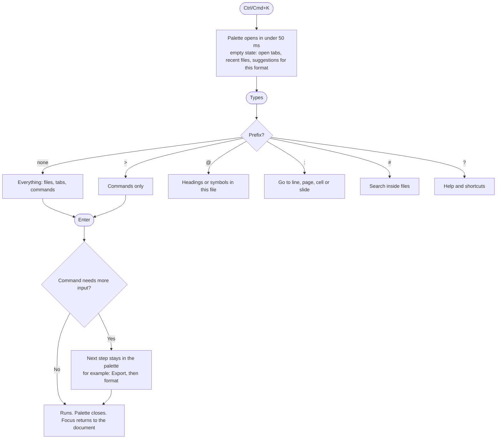
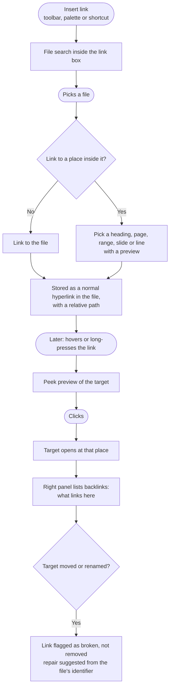
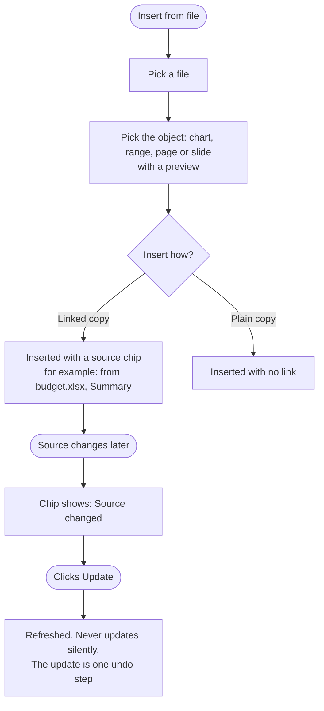

# Search, commands and links

## F-18 Find and replace in a file

The same shortcut and the same bar in every format.

## F-19 Search across files

Results land on the exact place, not just the file.

## F-20 Command palette

## F-21 Link two documents, follow a link, backlinks

## F-25 Insert content from another file

