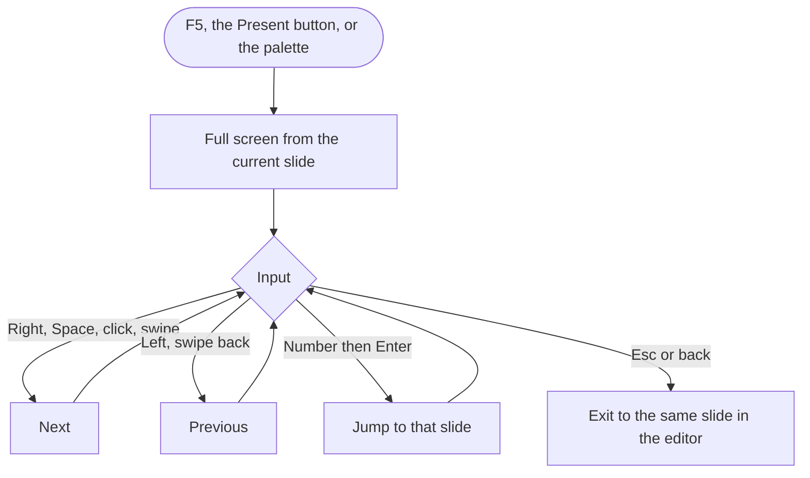
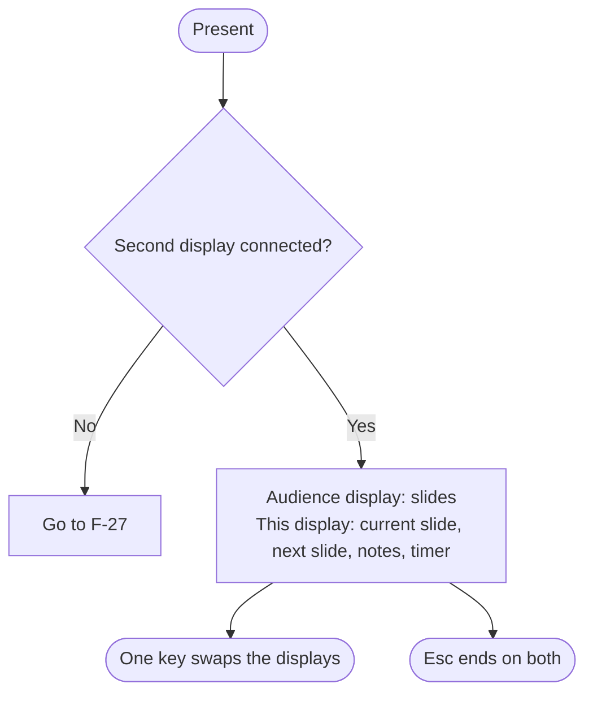
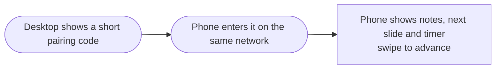

# Presenting slides

## F-27 Present on one screen

**Step target: 1 action.**

## F-28 Presenter view on two screens

## F-29 Phone as a remote

A later feature; mapped in one line until its phase.

