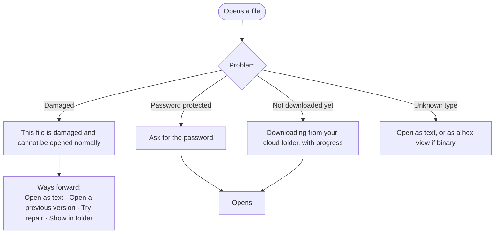
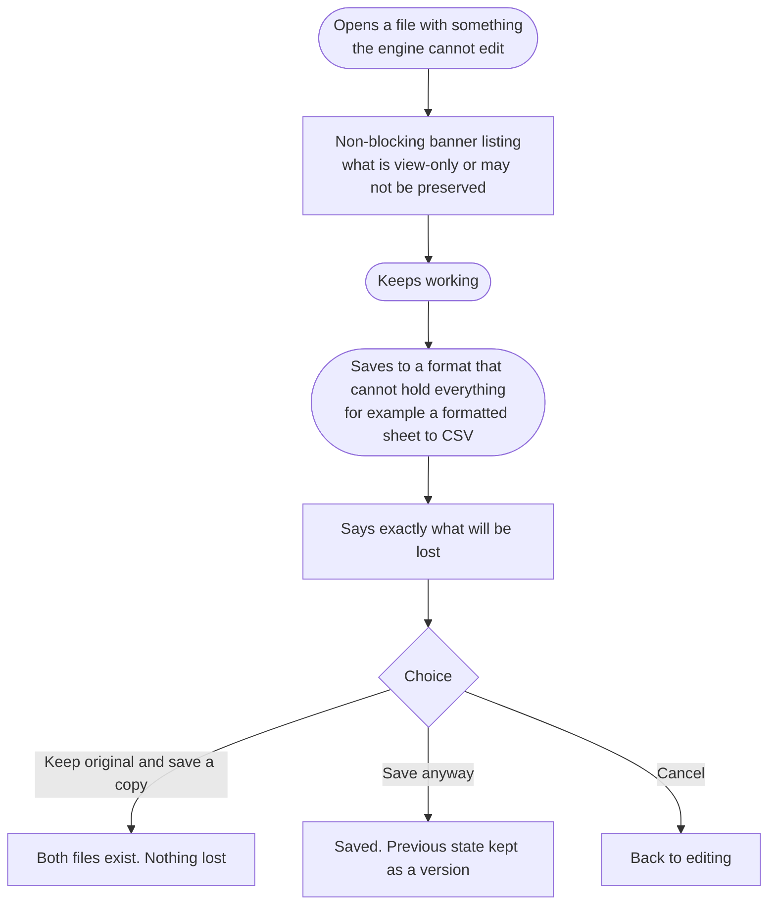
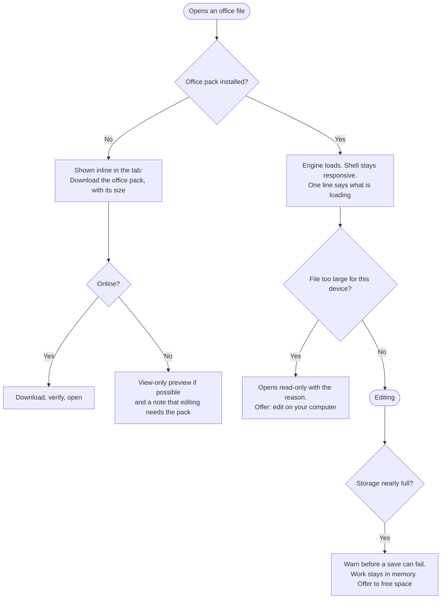
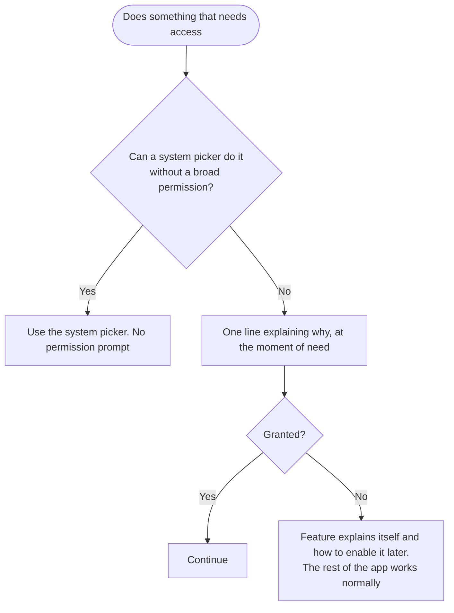
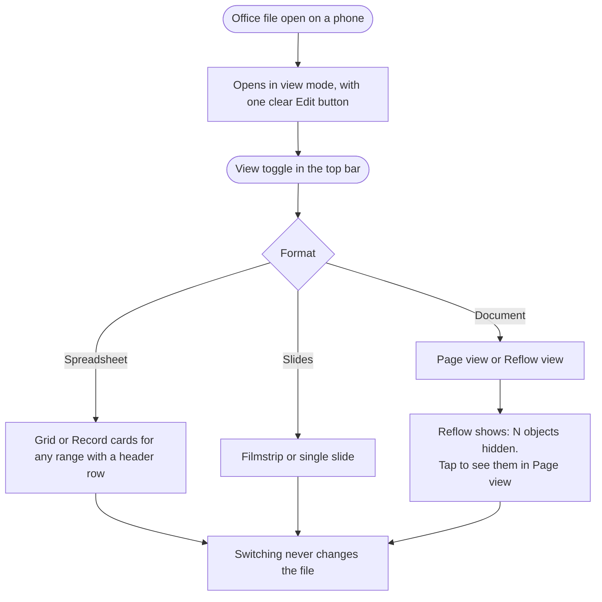

# Errors and limits

The rule for all of these: explain in plain words, and always offer a way forward.

## F-35 File cannot be read

## F-36 Unsupported feature or lossy save

## F-37 Missing engine pack, low storage, offline

## F-38 Permission prompts on phones

## F-41 Switch view on phones

