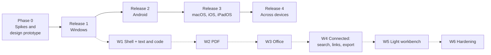

# 03 — Roadmap

Status: draft for review · Last updated: 2026-11-21

Four releases, in a fixed order: **Windows → Android → macOS and iOS/iPadOS → sync across devices.** Each ships and is used daily before the next begins.

Within each release the order is risk-first: prove the uncertain things with throwaway experiments, build the shell on the light formats, then bring in the heavy engine. Every phase ends with something usable and a written exit check. Durations are rough guesses for one person working with an AI coding assistant, not commitments.

## Phase 0 — Spikes, design prototype and decision gate (about 3–4 weeks)

Throwaway prototypes in a `spikes/` folder. Nothing here is kept as product code. Each spike ends with a short written result in `docs/decisions/`.

### Spikes that gate the Windows release

| # | Question | Pass means | Defined in |
|---|---|---|---|
| S13 | Is Tauri on Windows fast enough? | Launch, memory and size meet the budgets | `08` |
| S1 | Does the ONLYOFFICE client-side stack work inside the shell? Open docx, xlsx and pptx from bytes, edit, get bytes back | All three round-trip and reopen cleanly in Word/Excel/PowerPoint or LibreOffice | here |
| S14 | Do the office editors run correctly in WebView2 under Tauri? | Edit and save all three formats | `08` |
| S2 | Is the office engine fast and light enough? Cold load; a 50-page docx, a 100k-row xlsx, a 60-slide pptx; memory with 1, 5 and 10 tabs | Usable on your machine | here |
| S16 | What does a live office tab cost? | Hibernation plan is sufficient | `08` |
| S3 | Can the shell stay in control? Intercept the reserved shortcuts above the engine frame; draw the palette over it; trigger bold, save and export from outside | Shell shortcuts always win; an action bridge exists or a small patch is scoped | here |
| S4 | How much can the ONLYOFFICE interface be restyled? | A look acceptable for the first release without forking | here |
| S15 | How small can the office pack get? | Size target met, nothing broken | `08` |
| S5 | ONLYOFFICE or SuperDoc for documents? Same five real documents through both | A written choice | here |
| S6 | PDF.js or EmbedPDF? Annotate and sign in both; open results in Acrobat Reader, Preview and Edge | A written choice and a list of annotation types that survive everywhere | here |
| S7 | Does the light CSV grid keep files byte-identical? | Zero bytes changed on open-and-save | here |
| S8 | Does the text editor keep files byte-identical? Mixed line endings, BOMs, no final newline, non-UTF-8 | Zero bytes changed, or the exception is detected and warned about | here |
| S10 | Does CodeMirror 6 reach the VS Code feel, on desktop and on a phone? | A written choice | `06` |
| S11 | Does the language-server client work with a real server? | Go-to-definition and diagnostics work | `06` |
| S12 | Does highlighting stay fast on large files? | Meets the typing budget | `06` |
| S17 | Are the speed budgets realistic? | Every row measured | `08` |
| S9 | Does the fidelity harness work? | It reports a deliberately introduced corruption | `04` |
| S18 | Can links, bookmarks and properties be read and written in office files? | A method exists per format | `09` |
| S19 | Can a linked copy be inserted and refreshed from outside the engine? | Works, or the feature is deferred | `09` |
| S20 | Can each engine yield text with locations for the search index? | Page, cell, slide and line positions extracted | `09` |
| S21 | Does converter route-finding work end to end? | Multi-step conversion succeeds | `10` |
| S22 | How good are the top ten conversions on real files? | A measured label per pair | `10` |
| S24 | Is Windows' built-in OCR good enough? | Searchable PDF produced | `10` |

**Run order.** S13, then S1 and S14 together, then the rest in any order. S13, S1 and S14 decide whether the plan stands.

### Early look-ahead for mobile

Two cheap experiments now, so Windows-phase decisions are not made blind. The full device spikes (M1–M10 in `12-platforms-and-mobile.md`) run before their own phases.

| # | Question |
|---|---|
| M1 (early) | Does the office engine open and save a typical file in the Android webview on your phone at all? |
| M4 (early) | Do CodeMirror and PDF.js feel fast on your phone? |

### Design prototype, in parallel

A clickable browser prototype of the shell with fake documents, following `07-ux-ui-design.md` and the flow maps in `../flows/`:

- Tabs, palette, toolbar switching per format, sidebars, focus mode, home screen.
- At desktop width **and at phone width**, so the adaptive rules in `12-platforms-and-mobile.md` are tested before anything is built.
- The P1 flows walked through and their step counts recorded.

### Decision gate

If S13, S1 or S14 fails with no workable fallback, stop and reconsider before building anything. The options are: Electron as the Windows shell with a different mobile strategy later; a local ONLYOFFICE Document Server helper on desktop; or scoping the project down to text, code, PDF and CSV with office files handed to an installed suite.

---

## Release 1 — Windows

### W1 — Shell plus text and code (about 3–4 weeks)

The app becomes a real editor for any text or code file (the v1 tier in `06-code-and-text-editor.md`).

- Scaffold: Tauri v2, Rust core, the `platform` interface, Vite + React, pnpm workspace, lint, tests, CI.
- Design tokens, themes and the shell components from the prototype; responsive from the first screen.
- Performance and size budgets wired into CI from the first commit.
- `editor-api` package and provider registry.
- Tab strip, new/open/save/save-as, recent files, drag-and-drop, file associations.
- File pipeline on document handles: safe save, auto-save, snapshots, crash recovery, external-change detection, cloud-folder awareness.
- Command palette with commands, tabs and recent files.
- `engine-text`: CodeMirror 6 for every text-based file; highlighting and VS Code themes; language detection; built-in language services; schema-aware config editing; formatting; diff; Markdown live preview; JSON and image previews; outline, word count, focus mode.
- `engine-csv`: the light text-typed grid.
- Folder workspaces: file tree, fuzzy file finder, folder search.
- Light and dark theme, status bar, settings, Windows native details (title bar, snap layouts, jump lists).

**Exit check:** a week of note-taking and light coding in the app; open-and-save of any text file changes zero bytes; killing the process mid-edit loses nothing; every speed budget for text is met.

### W2 — PDF (about 2–3 weeks)

- `engine-pdf` with the engine chosen in S6: continuous scroll, zoom, search, text selection, outline, thumbnails.
- Annotations: highlight, sticky note, free text, ink (including Windows pen); annotation sidebar.
- Signature manager and placement.
- Page tools: reorder, rotate, delete, extract, split, merge across tabs.
- Form filling.
- Export text and Markdown to PDF.

**Exit check:** annotated and signed PDFs open correctly in Acrobat Reader, Preview and Edge; page operations pass a structure check.

### W3 — Office formats (about 4–6 weeks)

- Build script that downloads, pins, prunes and checksums the office pack; custom protocol; sandboxed frame; on-demand loading.
- `engine-office` adapter: load, serialize, dirty state, snapshot, suspend and resume.
- In order: **docx**, then **xlsx**, then **pptx**. Each is finished and verified before the next starts.
- Templates for each format.
- Palette bridge for office commands.
- Tab hibernation, live-tab cap and optional idle pre-warming.
- Full-screen presenting and display selection; presenter view.
- Bundled metric-compatible fonts.

**Exit check:** the round-trip suite in `04-verification.md` passes for each format on the sample corpus and on at least twenty personal files per format.

### W4 — Connected: search, links and export (about 4–5 weeks)

The part that sets the app apart (`09-differentiators-and-interconnection.md`, `10-universal-export.md`).

- The local index: full text with locations, links, backlinks, tags.
- Universal search landing on the exact page, cell, slide or line.
- Insert link to any file or location; follow; hover preview; backlinks panel; broken-link repair.
- PDF highlight → quote in a note, linked back to the page.
- Tags and properties across formats.
- The converter registry with route-finding; the Export sheet with quality labels and previews; Open as…; batch export.
- Version-history browser with compare for text and documents.
- Side-by-side split view with drag between panes.
- Embedded previews in Markdown; linked copies with Update, if S19 passed.

**Exit check:** every P1 and P2 flow in `../flows/` works on Windows, and the step counts beat or match the recorded incumbent counts.

### W5 — Light workbench (about 3–4 weeks)

The v2 tier in `06-code-and-text-editor.md`. Desktop only.

- Generic language-server client with servers discovered on the system PATH.
- Integrated terminal as a lazily loaded pack.
- Minimal git: gutter markers, changed files, diff, stage, commit.
- Replace across files; HTML preview, notebook and log viewers; Vim keybindings.

**Exit check:** a day of real coding in at least two languages without opening another editor.

### W6 — Hardening and Windows release (about 2 weeks)

- One end-to-end test per flow ID.
- Large-file and many-tab performance pass against every budget.
- The UX self-test script, keyboard-only and mouse-only.
- Installer; file associations.
- One week of exclusive daily use; fix what hurts.

**Exit check:** the "done" definition in `00-vision-and-scope.md`.

---

## Release 2 — Android

Starts only after Windows is in daily use. Before any build work: device spikes **M1–M5, M9 and M10** (`12-platforms-and-mobile.md`).

### A1 — The app on a phone and tablet (about 4–6 weeks)

- Tauri Android target; the `platform` implementation for Android: document handles through the system file picker with lasting permissions, "Open with", share-to-app, share sheet, back gesture.
- The compact and medium layouts from the prototype: tab switcher sheet, top and bottom bars, keyboard accessory bar, sheets and drawers, full-screen search.
- Text, code, Markdown and CSV editing with touch and the extra key row.
- PDF reading, annotation with finger and S Pen, signing, page tools.
- Search, links and backlinks from the shared core.
- Inbox on the device: share target, quick note, scan with on-device text recognition.
- Material styling: edge-to-edge, dynamic colour, adaptive layouts for foldables and tablets.

**Exit check:** all P1 flows pass at phone width on a real device; typing and scrolling meet the budgets on a mid-range phone.

### A2 — Office files on Android (about 3–5 weeks)

- Office pack served from app storage; one live heavy editor at a time.
- Tablets: the full editor with touch adjustments.
- Phones: view, comment and light edits, with the view toggle (flow F-41); file-size ceilings with honest read-only fallback.
- Native converter library if the webview route proved too limited in M1.
- Decision on the Euro-Office mobile editor from M9.

**Exit check:** the fidelity suite passes on Android for files edited there; nothing edited on the phone fails to reopen on Windows.

Until Release 4, files move between the PC and the phone by whatever you already do (a cable, a cloud app's own share button, email). The inbox share target and quick note are part of A1 because they work on a single device.

---

## Release 3 — macOS and iOS/iPadOS

Starts only after Android is in daily use. Before any build work: device spikes **M6–M8**. These decide whether Apple's webview can host the office editors at all.

### P1 — macOS (about 3–4 weeks)

- Tauri macOS target, or Electron for this platform only if M6 fails.
- Native menu bar, toolbars and sidebars; system file handling.
- Everything from the Windows release, including the light workbench.

### P2 — iPadOS and iOS (about 5–7 weeks)

- Tauri iOS target; the `platform` implementation: security-scoped bookmarks, Files app and iCloud Drive, share sheet, Apple Pencil.
- iPad: full layouts, menu bar, "Open in New Window", hardware keyboard and pointer.
- iPhone: the compact layout already proven on Android.
- Office files: iPad full editor if M6 passed; iPhone view and light edit; native converter library from M8 to get past the memory limit.
- PDF rendering adapted to the webview's canvas limits.
- Signing and distribution set up (the yearly developer fee, or weekly reinstall).

**Exit check for release 3:** a week of real work on each Apple device.

---

## Release 4 — Across devices (about 6–8 weeks)

Decided on 2026-11-22: the cloud and sync work comes last, after the app exists on every platform. The full design is in `11-sync-and-continuity.md`; the choice of cloud is made at the start of this release, with the spikes below run on your real devices.

Before any build work: sync spikes **S25–S30**.

- The hidden state folder with one writer per file; per-device sessions.
- "Continue from…" on the home screen; QR hand-off; deep links between devices.
- Conflict handling: three-way merge for text, keep-both with compare for office and PDF; the "open on another device" hint.
- Good behaviour inside cloud folders on desktop: placeholder awareness, adopting the provider's conflict copies.
- The route per platform: synced folder on Windows and macOS; local folder plus companion tool, or a built-in connector, on Android; iCloud Drive or a built-in connector on iOS.
- Handoff between Apple devices.
- One built-in connector if the folder approach is not smooth enough on phones.

**Exit check:** two weeks of working across all four devices with no lost edit and no unexplained duplicate file.

**What is still done early, in W1, so this release is an addition and not a rewrite:** stable file identifiers, relative links, document handles, safe saves, and keeping caches and indexes out of the documents folder. These cost almost nothing now and are expensive to retrofit.

---

## Later, optional

- "Edit text" mode for PDFs through the ONLYOFFICE PDF editor.
- Cryptographic signatures.
- Native shell toolbars replacing the ONLYOFFICE ribbon.
- Markdown slide decks.
- More formats: legacy doc/xls/ppt import, epub, iWork import.
- Document-AI conversion pack for PDF → Markdown on desktop.
- A lighter native spreadsheet engine (IronCalc) once it matures.
- Full office editing on phones.
- Language-server installer; tree-sitter; optional AI assistance.
- Phone as a presentation remote.
- Canvas or graph view of connected files.
- Linux.

## Why this order

- **Windows first** because it is where the work happens, every capability is available there, and its webview is the low-risk case.
- **Android second** because its webview is the same engine family as Windows, so the engines are most likely to carry over, and personal installs are free.
- **Apple third** because its webview is the unproven one, iOS has the tightest memory limit, and installing your own app there costs money or weekly effort.
- **Sync last** because it is the least certain area (no single cloud folder works well for third-party apps on all four platforms), it is best chosen with all your devices in hand, and the app is fully useful on each device without it.
- **Within Windows:** text and code first because that engine is small, used most, and exercises the whole shell; PDF second because it is independent of the office engine; office third because it carries the most risk; the connected layer fourth because it needs every engine in place; the workbench last because it deepens one format.
- **Design for phones from the first screen**, even though phones ship second, because retrofitting touch and small screens into a desktop interface is far more expensive than building it responsive from the start.

## Honest size of this

Four releases across four platforms is a long project for one person: by these rough estimates, about a year of full-time work even with AI assistance, and longer part-time. The plan is built so that it is useful long before the end. After W1 you have a text and code editor; after W2, a PDF tool; after W3, the all-in-one app on Windows. Each later phase adds to something already in daily use.
