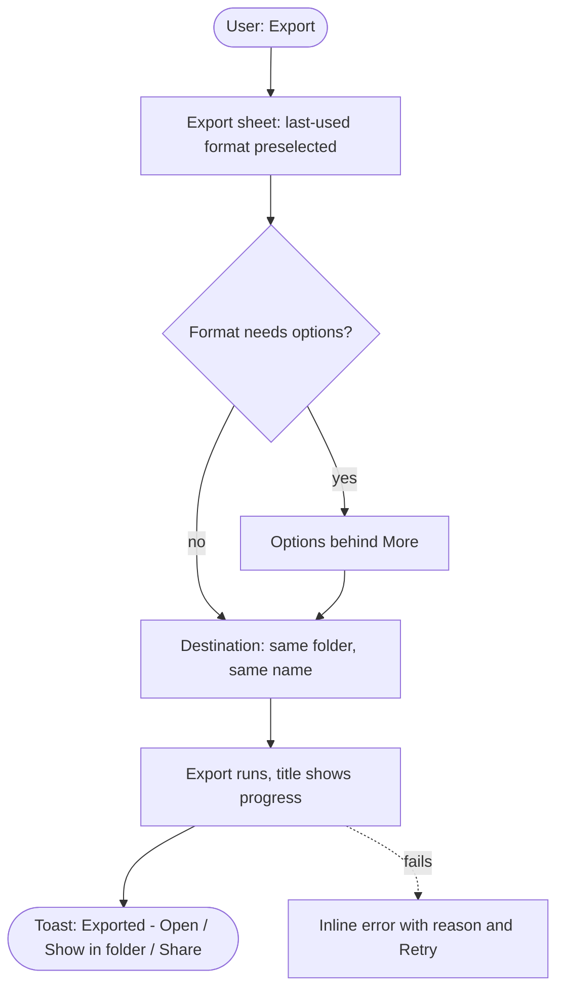

# Adaptive, multi-device UX design and user flows for the all-in-one document app (state as of 21 Nov 2026)

Evidence tags used on every finding:

- **[R]** = page read directly this session.
- **[S]** = search-result summary only (page not opened; treat wording as approximate).
- **[B]** = background knowledge from before this session; the URL is a pointer to where it should be verifiable, not a page opened this session.

Hosts that could not be fetched from this session (network allow-list): `api.onlyoffice.com`, `helpcenter.onlyoffice.com`, `www.macrumors.com`. Everything about those sources is [S] or [B]. They must be allowed in the session's network settings before the ONLYOFFICE mobile claims can be verified at source.

Scope note: the earlier note `docs/research/notes/ux-ui-design.md` covers the desktop shell (tab row, contextual toolbar, palette, focus mode, save-state UX, desktop accessibility, embedded-editor chrome). It lists "Material 3 guidance, Fluent 2 command-bar guidance, tablet/touch input, Craft/Things/Bear" as not researched. This note fills those gaps and does not repeat the desktop material.

---

## 1. Platform design languages in late 2026 and what "feels native" requires

### Takeaway
All three platform vendors changed their design language in 2025 and tightened it in 2026: Apple's Liquid Glass (OS 26) was toned down and made user-adjustable in OS 27; Android made adaptive, edge-to-edge and predictive back mandatory and Google Play will enforce adaptive quality from April 2027; Windows 11 remains Fluent 2 with Mica/rounded geometry. "Native" for a webview-based app means adopting each platform's *shell behaviours* (window chrome, back, insets, menus, bars, system colour/text-size settings), not re-skinning every control.

### Cited Findings

**Apple (iOS/iPadOS/macOS 26 and 27)**
- [S] Liquid Glass was introduced at WWDC 2025 as a system-wide translucent material for controls and navigation across iOS 26, iPadOS 26 and macOS Tahoe 26. — [Apple Newsroom, June 2025](https://www.apple.com/newsroom/2025/06/apple-introduces-a-delightful-and-elegant-new-software-design/)
- [S] Apple's HIG positions Liquid Glass as a separate functional layer for controls and navigation (tab bars, sidebars, toolbars) floating above content; it says not to use Liquid Glass in the content layer (transient controls such as sliders/toggles excepted) and to use the standard system materials for content. — [HIG: Materials](https://developer.apple.com/design/human-interface-guidelines/materials)
- [S] HIG toolbar and tab-bar pages say to avoid colouring bars similarly to labels/content backgrounds and to prefer a monochromatic bar appearance over colourful content. — [HIG: Toolbars](https://developer.apple.com/design/human-interface-guidelines/toolbars); [HIG: Tab bars](https://developer.apple.com/design/human-interface-guidelines/tab-bars)
- [S] Apple's adoption overview says standard bars pick up Liquid Glass automatically from system frameworks, and that apps should remove custom bar backgrounds/effects and let the system decide. — [Adopting Liquid Glass](https://developer.apple.com/documentation/technologyoverviews/adopting-liquid-glass)
- [S] Reception: a year of user complaints centred on readability of the transparency effects. In iOS 27 (announced WWDC, 8 June 2026) Apple changed how Liquid Glass is rendered ("improved material diffusion"), made icons "sharper and more defined", and added a system-wide slider for the strength of the effect; the slider was not shown in the keynote and arrived in Public Beta 1 on 13 July 2026. — [MacRumors, 10 Jun 2026](https://www.macrumors.com/2026/06/10/how-liquid-glass-is-changing-in-ios-27/); [TweakTown](https://www.tweaktown.com/news/112090/apple-is-adding-a-liquid-glass-slider-in-ios-27-after-a-year-of-user-complaints-about-readability/index.html); [Yanko Design, 28 Jul 2026](https://www.yankodesign.com/2026/07/28/wwdc-2026-six-weeks-later-what-actually-shipped/amp/)
- [S] macOS 27: all apps get a consistent window corner radius and sidebar icons regain colour. Early reactions "mostly positive" (Cult of Mac); Tom's Guide remains sceptical. — [Cult of Mac](https://www.cultofmac.com/news/liquid-glass-changes-ios-27-macos-27); [Tom's Guide](https://www.tomsguide.com/phones/iphones/ios-27-has-a-bunch-of-changes-including-a-refined-liquid-glass-design-but-how-much-has-changed-from-ios-26)
- [B] iOS 26.1 (late 2025) had already added a Clear/Tinted Liquid Glass setting as an interim response. Not verified this session. — [MacRumors article above](https://www.macrumors.com/2026/06/10/how-liquid-glass-is-changing-in-ios-27/)
- [S] iPadOS 26: Apple's guidance (WWDC25 session 208 "Elevate the design of your iPad app") is that when multitasking is enabled a document app should give **each document its own window**, name each window with a unique string such as the document title, and that the older "Open in Place" behaviour is no longer recommended. Every multitasking-capable app shows a resize handle bottom-right; apps not updated get a larger safe area above the toolbar "for compatibility" (the window controls sit top-leading). — [WWDC25 session 208](https://developer.apple.com/videos/play/wwdc2025/208/)
- [S] iPadOS 26 apps have a menu bar with system default menus plus app menus; revealed by swiping down from the top or moving the pointer to the top edge. Apple: menu bars "organize your app's actions, making them easier to discover". The menu bar also exposes system commands (text editing, window management). — [What's new in iPadOS 26](https://developer.apple.com/ipados/whats-new/); [MacStories review: The Menu Bar](https://www.macstories.net/stories/ios-and-ipados-26-the-macstories-review/11)
- [S] Holding the Command key on a hardware keyboard shows the current iPad app's shortcut list (users cannot disable it). — [Apple Support 102393](https://support.apple.com/102393)
- [B] iOS 26 bar conventions: tab bars float and can minimise on scroll, search is a separate trailing tab/button, toolbars group items into glass capsules and content scrolls under them with a "scroll edge effect". Document-based apps can use the system document launch scene / `UIDocumentViewController` (iOS 18+) and the Files-based document browser. macOS conventions: unified toolbar, leading sidebar, trailing inspector, full menu bar, Settings window (Cmd+,). Not verified this session. — [HIG: Tab bars](https://developer.apple.com/design/human-interface-guidelines/tab-bars); [UIDocumentViewController](https://developer.apple.com/documentation/uikit/uidocumentviewcontroller); [HIG: Inspectors](https://developer.apple.com/design/human-interface-guidelines/inspectors)

**Android (Material 3 Expressive, Android 16/17)**
- [S] Material 3 Expressive was announced May 2025 as an evolution of Material 3 (not "Material 4"): about fifteen new or updated components (new: button groups, FAB menu, loading indicator, split button, toolbars; updated: app bars, carousel, buttons, FABs, icon buttons, navigation bar, navigation rail, progress indicators), a shape library with 35 shapes and a spring-based motion system. It shipped on Pixels with Android 16 QPR1 in September 2025. — [Android Authority](https://www.androidauthority.com/google-material-3-expressive-features-changes-availability-supported-devices-3556392/); [9to5Google](https://9to5google.com/2025/05/13/android-16-material-3-expressive-redesign/)
- [S] Apps targeting Android 16 can no longer opt out of edge-to-edge (the opt-out attribute is removed), so they must handle window insets. Predictive back is on by default for apps targeting Android 16 (`enableOnBackInvokedCallback` defaults true; `onBackPressed`/`KEYCODE_BACK` are ignored). — [Android 16 behaviour changes](https://developer.android.com/about/versions/16/behavior-changes-16)
- [R] On displays of at least 600dp, Android 16 ignores manifest/runtime orientation and resizability restrictions; Android 17 (API 37) removes the temporary opt-out. — [Android Developers Blog, 19 Dec 2025](https://developer.android.com/blog/posts/goodbye-mobile-only-hello-adaptive); [19 May 2026](https://developer.android.com/blog/posts/adaptive-development-for-the-expanding-android-ecosystem)
- [R] Jetpack WindowManager 1.5.0 (Oct 2025) added two width classes, **Large (1200–1600dp)** and **Extra-large (1600dp+)**, on top of compact/medium/expanded; Google suggests three or four panes at those widths. Supported in Compose Material 3 adaptive 1.2. — [Android Developers Blog, 19 Dec 2025](https://developer.android.com/blog/posts/goodbye-mobile-only-hello-adaptive)
- [B] The base width classes are compact < 600dp, medium 600–839dp, expanded 840–1199dp; canonical layouts are list-detail, feed and supporting pane; navigation bar on compact becomes navigation rail on medium+. Not re-read this session. — [Use window size classes](https://developer.android.com/develop/ui/compose/layouts/adaptive/use-window-size-classes); [Canonical layouts](https://developer.android.com/develop/ui/compose/layouts/adaptive/canonical-layouts)
- [R] Connected Displays (phone drives a desktop environment on an external display) is stable as of Android 16 QPR3 on supported Pixel and Samsung devices. "Googlebook" laptops (next generation of ChromeOS built on parts of the Android stack; HP, Dell, Lenovo, Acer, Asus) run Android apps and have dedicated desktop design guidance. — [Android Developers Blog, 19 May 2026](https://developer.android.com/blog/posts/adaptive-development-for-the-expanding-android-ecosystem); [Design for desktop](https://developer.android.com/design/ui/desktop)
- [R] Google says adaptive quality "goes beyond window dimensions" to keyboard, trackpad, mouse and stylus; Compose 1.11 brings trackpad support on par with mouse and built-in focus rings. Google states it continues "full support for Web, Qt, and Unity" for cross-platform frameworks. — [same, 19 May 2026](https://developer.android.com/blog/posts/adaptive-development-for-the-expanding-android-ecosystem)
- [R] **Google Play enforcement (announced 18 Nov 2026):** from **April 2027** new apps and updates must meet at least **Tier 3 "Adaptive ready"** (fill the display without letterboxing; preserve state such as scroll position and text input across rotation, fold/unfold and resize; support multi-window) and must supply 3 foldable screenshots in addition to 2 phone screenshots. Apps that fail "will no longer be able to publish or update". From **August 2027** new and updated apps must target API 37. Tier 2 "Adaptive optimized" (multi-pane layouts, basic external keyboard/mouse/trackpad/stylus support) and Tier 1 will be folded in progressively and earn store badging. — [Android Developers Blog, 18 Nov 2026](https://developer.android.com/blog/posts/google-play-adaptive-quality-standards)

**Windows 11 (Fluent 2)**
- [S] Microsoft recommends Mica as the base layer, especially in the title bar; it samples the wallpaper once so it is cheap. Showing Mica in the title bar requires extending the app into the non-client area with a transparent custom title bar. Mica Alt is meant for tabbed title bars. — [Materials in Windows 11](https://learn.microsoft.com/en-gb/windows/apps/design/signature-experiences/materials); [Mica](https://learn.microsoft.com/windows/apps/design/style/mica)
- [S] Microsoft warns that a custom title bar or custom caption buttons can stop the Snap Layouts flyout appearing on the maximise button, and documents how to keep it. — [Support snap layouts for desktop apps](https://learn.microsoft.com/en-us/windows/apps/desktop/modernize/ui/apply-snap-layout-menu)
- [S] Electron: `titleBarOverlay` draws native window controls over a custom title bar (height and colours configurable); snap-layout support landed in Electron 13; `backgroundMaterial` (Mica/Acrylic) exists since Electron 26, with a later fix for the background turning black on maximise. No source confirmed that `titleBarOverlay` + `backgroundMaterial: 'mica'` together keep the snap flyout; this must be tested. — [Electron: Custom Title Bar](https://electronjs.org/docs/latest/tutorial/custom-title-bar); [Electron PR 29600](https://github.com/electron/electron/pull/29600)
- [S] Precedent for webview-heavy apps: Edge restored a Mica title bar in v140+ behind an Appearance toggle; Chrome's Mica title bar is still a flag. — [Pureinfotech](https://pureinfotech.com/enable-mica-microsoft-edge/); [Windows Report](https://windowsreport.com/?p=1485147)
- [B] Other Windows 11 "native" markers: 8px window corners and 4px control corners, Segoe UI Variable, system accent colour, light/dark and High Contrast themes, Text size scaling (Settings > Accessibility), rounded context menus with icons and shortcut hints, taskbar Jump Lists (recent files and tasks), touch/pen input via pointer events and Windows Ink. Not verified this session. — [Geometry in Windows 11](https://learn.microsoft.com/windows/apps/design/signature-experiences/geometry); [Menus and context menus](https://learn.microsoft.com/windows/apps/design/controls/menus-and-context-menus); [Fluent 2](https://fluent2.microsoft.design/)

**Cross-platform apps**
- [S] Obsidian mobile keeps the desktop model but re-maps it: an editing toolbar of icons at the bottom while editing (user-configurable, horizontally swipeable), and a pull-down "Quick Action" gesture that opens the command palette by default and can be re-bound to any command. — [Obsidian Help: Mobile app](https://obsidian.md/help/mobile)

### Inferences
- The cheapest way to "feel native while staying one product" is a three-layer split: (a) **platform-owned chrome** — window frame/controls, back gesture, insets, system menu bar (macOS/iPadOS), share sheet, file pickers, text selection handles, context-menu shape; (b) **shared product layer** — own icon set, type scale, colour roles, spacing, the palette, the tab model, verbs; (c) **per-platform token overrides** — corner radii, bar material (Mica on Windows, system glass on Apple where the bar is a native bar, tonal surface on Android), control height, motion curve. One token set with four small override files.
- Liquid Glass's own rule ("glass for navigation only, never content") and the 2026 toning-down both argue for **not imitating glass in CSS**. Use plain opaque/blurred bars from tokens inside the webview; if a native bar is used on Apple platforms, the system supplies the material. Faked glass will also ignore the user's new iOS 27 strength slider.
- Android's April 2027 Play rule turns "adaptive" into a publishing gate. Tier 3 is easy for a webview app (resizable, state-preserving), but state preservation across fold/resize must be tested with the embedded office engine (it must not reload the document on a configuration change).
- iPadOS 26 guidance (one window per document, menu bar) conflicts mildly with the product's in-app tab row. Reasonable resolution: keep in-app tabs as the default, and also support "Open in New Window" per document plus a populated menu bar; on macOS the menu bar is mandatory.
- On Windows the title bar is the single most visible native signal: put the tab row in the title bar (Mica Alt is intended for exactly this), keep system caption buttons via overlay, and verify Snap Layouts.

### Gaps
- No source read on how Notion, Linear, Microsoft 365 mobile, Google Docs, Bear, Craft, Figma or Spotify currently balance brand and platform conventions; only Obsidian was covered ([S]). [B] recollection (unverified): Things and Bear are Apple-only native apps; Spotify and Notion keep one brand UI on every platform; Google Docs uses Material on iOS too. Needs teardown sources (Mobbin etc.) before being asserted.
- HIG pages, Fluent 2 site and m3.material.io were not opened directly; Apple and Microsoft findings are [S]/[B].
- Whether iOS/iPadOS/macOS 27 changed toolbar or tab-bar *conventions* (beyond rendering) was not found.
- Windows Window Controls Overlay (the PWA feature) and WebView2/Tauri title-bar specifics were not found; only Electron was.

---

## 2. Adaptive layout strategy: size classes and what each shell element becomes

### Takeaway
Use the Android/Material width classes as the single breakpoint system on every platform (compact < 600, medium 600–839, expanded 840–1199, large 1200+), driven by *window* width, not device type. Each desktop shell element has one defined transformation per class; the document always keeps the most pixels.

### Cited Findings
- [R] Google's adaptive guidance defines Large (1200–1600dp) and Extra-large (1600dp+) as the point to move from two panes to three or four. — [Android Developers Blog](https://developer.android.com/blog/posts/goodbye-mobile-only-hello-adaptive)
- [B] Compact < 600dp, medium 600–839dp, expanded 840–1199dp; height classes also exist (compact height < 480dp matters for phones in landscape with the keyboard up). — [Use window size classes](https://developer.android.com/develop/ui/compose/layouts/adaptive/use-window-size-classes)
- [R] Tier 3 requires state preservation (scroll position, text input) through rotation, folding and resizing, and multi-window support. — [Google Play adaptive standards](https://developer.android.com/blog/posts/google-play-adaptive-quality-standards)
- [S] iPad: with windowing, an iPad app window can be any size, so iPad layouts must also respond to window width, and the window controls occupy the top-leading corner of the toolbar. — [WWDC25 session 208](https://developer.apple.com/videos/play/wwdc2025/208/)
- [S] Obsidian mobile: bottom editing toolbar plus pull-down for the command palette is a shipped example of "palette → gesture + full-screen search" and "toolbar → above-keyboard bar". — [Obsidian Help: Mobile](https://obsidian.md/help/mobile)
- [S] A foldable caveat from Excel: Cards View can disappear on a Galaxy Fold's unfolded screen because the app switches to its tablet layout there. — [WPS support note](https://www.wps.com/office-quick-solution/others/fix-cards-view-missing-in-excel-for-android-on-galaxy-fold/)

### Inferences (recommended rules — design proposals, not sourced facts)

| Shell element (desktop baseline) | Compact (< 600) phone | Medium (600–839) small tablet / folded-open / narrow window | Expanded (840–1199) tablet landscape / half-screen desktop | Large (1200+) desktop |
|---|---|---|---|---|
| Tab row | Hidden. A tab-count button in the top bar opens a **tab switcher sheet** (list or 2-column grid with thumbnails, swipe to close, "+" for new). Swipe left/right on the top bar switches adjacent tabs. | Scrollable tab strip, compact (icon + truncated title). | Full tab strip. | Full tab strip in the title bar. |
| Contextual toolbar | Split in two: a **top bar** (back/home, title + save state, undo, overflow "…") and a **bottom bar** (5 most-used tools for the format + "more"). When the keyboard is up, the bottom bar becomes the **keyboard accessory bar**. | Single top toolbar, lower-priority groups collapse into overflow. | Full toolbar. | Full toolbar. |
| Left sidebar (files / outline / thumbnails) | Full-height **drawer** from the leading edge, or a bottom sheet for outline/thumbnails. | Overlay drawer (dismisses on tap outside). | Docked, collapsible (list-detail). | Docked. |
| Right panel (format / comments / properties) | **Modal bottom sheet** with detents (half, full). | Side sheet overlay. | Docked supporting pane. | Docked; a third pane is allowed. |
| Command palette (Ctrl/Cmd+K) | **Full-screen search page** opened from a search button or pull-down; results are large rows; same commands. | Centred sheet, 80% width. | Centred popover. | Centred popover. |
| Status bar | Removed. Save state moves into the title; other items become **chips in the overflow** or a one-line info sheet (word count, zoom, page n/m). | Thin bar with 2–3 items. | Full thin bar. | Full thin bar. |
| Split view (two documents) | Not offered. Use tab switch; "peek" a linked document in a sheet. | Optional 50/50 only in landscape. | Yes, two panes. | Yes, two or three panes. |
| Find in file | Top bar turns into a find field; next/previous on the accessory bar. | Inline bar under toolbar. | Inline bar. | Inline bar. |
| Home / start | Recents-first list is the root screen; system back from a document returns here. | Same, 2-column grid. | Home is a tab. | Home is a tab. |
| Focus mode | Default behaviour: bars auto-hide on scroll, reappear on reverse scroll or tap. | Toggle. | Toggle. | Toggle. |

- Other rules: decide by window width so that a narrow desktop window, a Snap Layouts third, an iPad Slide Over-size window and a phone all get the same compact shell; never unload a document on a class change; keep one bottom bar maximum on compact (never bottom bar + bottom tab bar); treat compact *height* (landscape phone, keyboard up) as "hide everything but the accessory bar".
- Phone navigation model for a multi-document app: a browser-style model fits better than an OS-file-manager model — recents-first home, tabs as a switcher sheet with a visible count, system back = "close this layer" (sheet → find bar → document → home). Predictive back on Android should preview the home/recents screen.

### Gaps
- No sources were read on how Chrome, Safari or Arc Search present many tabs on phones, or on Files-based document browsers; the phone navigation recommendation is inference from general familiarity. [B] pointer for the Apple pattern: [UIDocumentBrowserViewController](https://developer.apple.com/documentation/uikit/uidocumentbrowserviewcontroller).
- No measured data on thumb reach or bottom-vs-top toolbar performance was collected.

---

## 3. Editing on touch, per format: best current implementations and their patterns

### Takeaway
The recurring winning pattern on phones is "a reading/entry-optimised alternative view next to the faithful layout view" (Word Mobile View, Pages Screen View, Excel Cards View, Acrobat Liquid Mode), plus a small, customisable bar above the keyboard. Each of these alternative views has documented fidelity limits, which is the opening to do better.

### Cited Findings

**Documents**
- [S] Word on phones opens in Print Layout; a "Mobile View" (reflow) button at the top switches views. Microsoft notes Mobile View "does not render certain objects like Ink (signatures) and Shapes" and can cause loss of context. — [Microsoft Support: Mobile View and Print Layout in Word Mobile](https://support.microsoft.com/en-US/Word/mobile-view-and-print-layout-in-word-mobile); [Use Word views](https://support.microsoft.com/en-us/office/use-word-views-to-read-or-edit-your-document-bb918d39-fa40-461c-b503-873eddbdda43)
- [S] Third-party support pages report the Word reflow view has been limited to phones and is missing on Android tablets (unofficial, unconfirmed). — [WPS support note](https://www.wps.com/office-quick-solution/office-app-problems/why-is-microsoft-word-mobile-view-missing-on-android-tablets/)
- [S] Pages on iPhone has "Screen View", a version of a word-processing document optimised for the iPhone display that can still be edited; turning it off shows the full page layout. — [Apple Support HT212747](https://support.apple.com/en-us/HT212747)

**Spreadsheets**
- [S] Excel mobile "Cards View" shows an Excel *table* one row per card for viewing and editing on a phone; opened from an icon that appears when a table cell is selected; "+" adds a row, deleting a card deletes the row. It works only with tables (not ranges, not with merged cells). GA on mobile since 2020. — [Microsoft Support: Cards View](https://support.microsoft.com/en-us/office/use-cards-view-to-work-with-table-data-on-your-phone-fda6099e-2de8-4a52-a926-90a7ee61a32b); [Microsoft Tech Community](https://techcommunity.microsoft.com/blog/microsoft_365blog/cards-view-in-excel-now-generally-available-on-mobile/1266783); [How-To Geek](https://www.howtogeek.com/826957/how-to-easily-work-with-excel-tables-in-the-mobile-app/)
- [B] Numbers on iPhone/iPad offers Forms (one record per screen bound to a table) and context-specific keyboards (numeric, date/time, formula). Not verified this session. — [Numbers User Guide for iPhone](https://support.apple.com/guide/numbers-iphone/welcome/ios)

**Presentations**
- [S] Keynote: an iPhone can act as a remote for a presentation on a Mac, iPad or another iPhone; the remote can show Current and Notes, Next and Notes, or Notes Only; pairing uses a four-digit code with both devices on Wi-Fi. An iPhone can also play to a separate display. — [Keynote for iPhone: Use a remote](https://support.apple.com/guide/keynote-iphone/tan9e9970a4/ios); [Play on a separate display](https://support.apple.com/guide/keynote-iphone/tana4da2681/ios)

**PDF**
- [S] Acrobat mobile Liquid Mode reflows a PDF for small screens using Adobe's ML to detect structure, builds a tappable outline, offers text size and spacing controls, leaves the original file unchanged (exit returns to the original), and does not apply to files over 200 pages. It is a reading view; commenting and signing are separate. — [Adobe Help: Liquid Mode](https://helpx.adobe.com/acrobat/mobile/view-manage-files/liquid-mode.html); [TechCrunch 2020](https://techcrunch.com/2020/09/23/adobes-liquid-mode-uses-ai-to-automatically-redesign-pdfs-for-mobile-devices)
- [S] 2026 comparison reviews: Notability is praised for low-latency writing and audio sync; Goodnotes is described as the deeper PDF tool; PDF Expert is rated best for everyday PDF editing on Apple devices (form filling, page management, signatures, text editing) but criticised for lacking measurement tools and reusable markups; Drawboard is rated best for pen-first technical markup. Most of these sources are vendor or affiliate blogs. — [Setapp review](https://setapp.com/app-reviews/goodnotes-vs-notability); [Paperlike](https://paperlike.com/blogs/paperlikers-insights/app-review-goodnotes-vs-notability); [Drawboard blog](https://www.drawboard.com/blog/best-pdf-apps-ipad); [iMore](https://www.imore.com/best-pdf-management-apps-ipad)
- [B] Stylus capabilities to design for: Apple Pencil hover preview, double-tap and (Pencil Pro) squeeze for a tool palette; S Pen button and hover; palm rejection is provided by the OS when the app distinguishes pen from touch pointer types. Not verified this session. — [HIG: Apple Pencil and Scribble](https://developer.apple.com/design/human-interface-guidelines/apple-pencil-and-scribble)

**Markdown / notes**
- [S] Obsidian mobile: configurable toolbar of icons at the bottom while editing (Settings → Interface → Configure mobile toolbar), long toolbars swipe horizontally, any global command can be added; pull-down Quick Action opens the command palette by default. Community plugins that add a second toolbar row or keep the toolbar always visible indicate users want more than one row. — [Obsidian Help: Mobile](https://obsidian.md/help/mobile); [Double row toolbar plugin](https://community.obsidian.md/plugins/double-row-toolbar); [Advanced Toolbar](https://github.com/phibr0/obsidian-advanced-toolbar)

**Code**
- [B] CodeMirror 6 has first-class mobile/touch support whereas Monaco is not supported on mobile browsers (already recorded in `documents-docx-markdown-text.md` and `code-editor-engines.md` in this repo). — [Replit: Betting on CodeMirror](https://replit.com/blog/codemirror); [Monaco README](https://github.com/microsoft/monaco-editor)

### Inferences (recommended per-format touch model — design proposals)
- **Shared rules for all formats on touch:** system text-selection handles and system context menu (cut/copy/paste/look up) are never replaced; one accessory bar above the keyboard with at most ~8 visible actions and horizontal scroll, always starting with undo/redo and ending with "hide keyboard"; long-press = context menu; two-finger tap is not relied on; pinch = zoom everywhere; every destructive action is undoable; view mode is the default on phones for office files with a single obvious "Edit" affordance.
- **Documents (.docx):** two views with a one-tap toggle in the top bar: *Page* (faithful) and *Reflow* (phone width). Improve on Word by showing a "N objects hidden in reflow" chip that jumps to them in Page view, instead of silently dropping shapes/ink. Accessory bar: undo, redo, bold, italic, style picker, list, indent/outdent, insert (+), comment.
- **Spreadsheets:** grid with large selection handles and a pinned formula bar above the keyboard; keyboard switches by cell type (numeric pad with operators, date, text, function picker). Offer a *Record/Card* view for any range with a header row (not only formal tables — the documented Excel limit). Tap column header for sort/filter/freeze sheet. Double-tap cell = edit; drag handle = extend selection; long-press drag = move.
- **Presentations:** phone default is slide-sorter (vertical filmstrip) → tap to open one slide for text edits; layout-level work is deferred to tablet/desktop. Presenting from the phone: full-screen with tap/swipe to advance and a notes sheet; "remote" mode controlling the desktop app shows next slide + notes + timer (Keynote's three layouts are the model).
- **PDF:** continuous scroll reading by default, thumbnail grid for page management (drag to reorder, multi-select to rotate/delete/extract), annotation tool strip that appears on pen contact (pen draws, finger scrolls — the standard palm-rejection contract), signature flow saved once and placed by tap. A reflow reading view is high-effort (Adobe needed ML) and should be out of scope.
- **Markdown / text:** live-preview editor; accessory bar with heading, list, checkbox, link, code, indent, plus cursor-move keys; user can reorder the bar (Obsidian precedent). 
- **Code / plain text:** extra key row (Tab, Esc, braces, brackets, quotes, slash, pipe, arrows), spacebar-drag cursor left to the OS; read-mostly on phones (search, small fix, share).

### Gaps
- Not found/read this session: Google Docs/Sheets mobile editing patterns, Craft, Notion and Bear mobile editors, iA Writer's keyboard bar, Runestone/Textastic/Code App/Acode extra key rows, Xodo, Samsung Notes, PowerPoint mobile editing and presenter-remote, Excel mobile formula bar/numeric keypad details, zoom-to-write boxes. Recommendations for those areas are inference from general familiarity.
- App-store review themes were not collected; review evidence for PDF apps is from vendor/affiliate comparison posts ([S]) and is not neutral.
- No verification of which Apple Pencil/S Pen events are exposed to a webview (pointer events `pointerType: "pen"`, pressure, tilt, hover) on each platform.

---

## 4. ONLYOFFICE's mobile web editors: what they offer and how far they can be themed

### Takeaway
ONLYOFFICE's phone UI is a separate Framework7 + React app per editor with its own (Framework7-style) look. Official customisation on mobile is limited to a handful of config parameters, and custom themes are reported not to apply to the mobile editors. Making it match the host app means forking/patching the Less sources of `web-apps/apps/*/mobile`, which is the main cross-device consistency risk.

### Cited Findings
- [R] `web-apps/apps/documenteditor/mobile` contains `locale/`, `resources/`, `src/` and a README that identifies it as a **Framework7 app using React**, split-view template, **Less** as the CSS preprocessor, **webpack** as bundler, Framework7 icon fonts, with scaffold options `"customColor": false`, `"color": "#007aff"`, `"darkTheme": false`, `"fillBars": false`. (The scaffold values describe how the project was generated; they do not prove dark mode is absent in the shipped UI.) — [GitHub ONLYOFFICE/web-apps, documenteditor/mobile](https://github.com/ONLYOFFICE/web-apps/tree/master/apps/documenteditor/mobile)
- [S] Official docs: only these customisation parameters are available for the mobile editors: `close`, `feedback`, `goback`, `help`, `logo`, `macrosMode`, `mobile`, `toolbarHideFileName`, `uiTheme`. — [ONLYOFFICE API: Customization (standard branding)](https://api.onlyoffice.com/docs/docs-api/usage-api/config/editor/customization/customization-standard-branding/)
- [S] ONLYOFFICE staff reply in the community forum: a custom theme works only in the desktop-layout editors and appears in the theme list there; it does not apply or show in the mobile editors. — [ONLYOFFICE community: Custom Theme … Not Reflecting](https://community.onlyoffice.com/t/custom-theme-set-as-default-but-not-reflecting-in-editor/15423)
- [S] Community threads exist about restyling the editors with fully custom styles and about the header/toolbar colour being inconsistent on mobile (contents not read). — [Modify OnlyOffice app styles](https://community.onlyoffice.com/t/modify-onlyoffice-app-styles-to-totally-custom-ones/14437); [Header toolbar color not consistent on mobile](https://community.onlyoffice.com/t/header-toolbar-color-not-consistent-on-mobile/16740)
- [S] The Euro-Office fork notes its mobile and forms logo fields live in a separate per-theme config "because the mobile editors use webpack, not Grunt" — i.e. the mobile UIs have a different build pipeline from the desktop-layout UIs. — [web-apps fork README](https://github.com/MarsEB71/web-apps)
- [S] ONLYOFFICE's help centre has a "Document Editor web version" page under its mobile section covering navigation, cut/copy/paste, inserting autoshapes, etc. (page not readable from this session). — [ONLYOFFICE Help Center](https://helpcenter.onlyoffice.com/mobile/ios/web/document-editor)
- [S] The native ONLYOFFICE Documents apps kept moving in 2025–2026 (iOS 9.0–9.2: camera text recognition, drawing in sheets and slides, improved in-editor search; Android 9.4, June 2026: redesigned toolbar, new slide designs). These are the native apps, not the mobile web editors. — [ONLYOFFICE blog: Android 9.4](https://onlyoffice.com/blog/2026/06/documents-android-9-4); [iOS 9.2](https://onlyoffice.com/blog/2025/12/onlyoffice-documents-v9-2-for-ios)
- [R, from repo notes] Size: the mobile UI variants are about 13 MB (word) and 20 MB (cell), about 33 MB raw across editors; the desktop pack plan had proposed *dropping* them. — `docs/research/notes/performance-and-footprint.md` (lines 128, 174); [source cited there](https://www.npmjs.com/package/@kreijstal/eurooffice-web-apps-2)
- [B] Recollection of the mobile web UI (unverified this session): top navbar with back, undo/redo, "Edit" (brush) sheet for text/paragraph/table/shape/image, "+" insert sheet, collaboration (comments, review) and a Settings sheet (find/replace, document/sheet/presentation settings, download-as, print, a "Mobile view" reflow toggle in the document editor and a dark-mode switch); the `customization.mobile` object has `forceView` (open in view mode first, default true) and `standardView` (use the desktop layout on mobile); Framework7 renders an iOS theme on Apple devices and a Material ("md") theme on Android. — [ONLYOFFICE API: Customization](https://api.onlyoffice.com/docs/docs-api/usage-api/config/editor/customization/customization-standard-branding/); [Framework7 React colours/themes](https://framework7.io/react/colors)

### Inferences
- The embedded engine brings its own phone UI with its own bars, sheets and icons. On desktop the plan was to hide engine chrome and drive it from the host toolbar; on phones the realistic options are: (A) accept the Framework7 mobile UI inside the document area and strip the host shell to a minimal top bar (cheapest, visibly "two apps"); (B) fork the mobile Less variables/icons to match host tokens (moderate; a patch set to maintain against upstream on every engine update); (C) hide the engine's mobile chrome and drive it from host-native bars through the editor API (highest effort; depends on how much of the mobile UI is reachable via the Document Builder/connector API, which is unverified). Recommend A for the first Android build, B where it is cheap (accent colour, bar colours, radius, font), and C only for the top five commands per format.
- If Framework7 auto-switches iOS/Material themes by user agent, the office editors will look *different on Android and iOS* while Markdown/PDF/code (host-rendered) look the same — a second axis of inconsistency to test.
- The desktop size plan (drop `mobile/` to save ~33 MB) must be made per platform: the Android/iOS packs need `mobile/` and can drop `main/` instead, if the tablet experience is acceptable in the mobile UI; otherwise tablets need both.
- `uiTheme` being in the mobile-allowed list suggests light/dark can at least be synced with the host theme; verify.
- Running the full x2t/sdkjs engine inside a mobile webview (memory, cold start, WASM limits on iOS WKWebView) is a larger risk than the UI skin and is outside this note's evidence.

### Gaps
- Could not read ONLYOFFICE API docs or help centre (hosts blocked): the exact semantics of `mobile.forceView` / `mobile.standardView`, whether `uiTheme` works on mobile, and the per-editor mobile feature list are unverified.
- `src/` of the mobile apps (Less variable files, theme structure, dark-theme classes) was not inspected; how much can be re-themed by overriding CSS variables vs rebuilding is unknown.
- Licence/branding obligations when modifying the mobile UI (AGPL, logo requirements) were not checked here; see `office-suite-engines.md`.
- No hands-on or reviewer assessment of the quality of ONLYOFFICE mobile web editing (latency, selection, keyboard handling) was found.

---

## 5. Input modalities to design for

### Takeaway
Treat keyboard + pointer as first-class on tablets (Google now grades it; iPadOS exposes a menu bar and a shortcut overlay), and treat pen as "draw immediately, finger navigates". OS integration points (share sheet, open-with, drag and drop, jump lists/quick actions) are where a multi-format app can save the most steps.

### Cited Findings
- [R] Google's Tier 2 "Adaptive optimized" evaluates basic support for external keyboard, mouse, trackpad and stylus on large screens; Compose 1.11 adds trackpad parity and standard focus rings. — [Google Play adaptive standards](https://developer.android.com/blog/posts/google-play-adaptive-quality-standards); [Adaptive development, May 2026](https://developer.android.com/blog/posts/adaptive-development-for-the-expanding-android-ecosystem)
- [S] iPad: holding Command shows the app's keyboard shortcuts (generated from the commands the app declares); iPadOS 26 adds a menu bar populated by the app's commands. — [Apple Support 102393](https://support.apple.com/102393); [What's new in iPadOS 26](https://developer.apple.com/ipados/whats-new/)
- [S] Obsidian's pull-down Quick Action is a shipped touch equivalent of a keyboard-invoked palette. — [Obsidian Help: Mobile](https://obsidian.md/help/mobile)
- [B] Other system hooks (not verified this session): Windows taskbar Jump Lists; Android app shortcuts (long-press icon), share targets and Quick Settings tiles; iOS/iPadOS share extensions, Home Screen quick actions, widgets and Spotlight indexing (Core Spotlight); drag and drop between apps on iPadOS, Android large screens and desktop; system dictation via the keyboard on all four platforms. — [Android: App shortcuts](https://developer.android.com/develop/ui/views/launch/shortcuts); [HIG: Drag and drop](https://developer.apple.com/design/human-interface-guidelines/drag-and-drop); [HIG: Home Screen quick actions](https://developer.apple.com/design/human-interface-guidelines/home-screen-quick-actions); [Windows: Jump lists](https://learn.microsoft.com/windows/apps/design/shell/tiles-and-notifications/jump-lists)

### Inferences
- One command registry should feed every surface: palette, toolbar, context menu, macOS/iPadOS menu bar, the iPad Command-hold overlay, Android's shortcut helper and the in-app cheat sheet. Declaring commands once with id, label, shortcut per platform and "available when" is what makes the system overlays populate for free.
- Modality matrix to design against (per command: how is it reached by touch, by keyboard, by pointer, by pen?): every top-20 command must have a touch path of at most two taps and a keyboard path on tablets.
- Pen: pen-down on a PDF or slide starts ink with the last-used tool without a mode switch; finger continues to scroll/zoom; pen hover (where available) previews the tool size. On documents and sheets, pen acts as a precise pointer unless an ink tool is armed.
- Priority order for OS integration (value per effort): open-with/file associations and share-to-app (both are "open" flows) → drag-and-drop in → share sheet out (export + share) → jump list/app shortcuts ("New document", recent files) → widgets and system search (defer).
- Voice: rely on OS keyboard dictation; do not build voice commands.

### Gaps
- Android's hardware-keyboard shortcut helper and how apps publish shortcuts to it were not sourced.
- No source on webview access to stylus hover/squeeze events per platform, or on Windows Ink integration from a webview.
- Widgets/quick-capture conventions per platform were not researched.

---

## 6. User-flow inventory and best-practice patterns

### Takeaway
About 40 flows cover the product; 12 of them account for nearly all daily use and should be mapped first, at all size classes. Each flow below has an ID so that diagrams, tests and issues can reference the same thing.

### Cited Findings
- [S] NN/g defines a user flow as "a set of interactions that describe the typical or ideal set of steps needed to accomplish a common task performed with a product", distinct from the broader user journey. — [NN/g: User Journeys vs. User Flows](https://www.nngroup.com/articles/user-journeys-vs-user-flows/)
- [S] iPadOS guidance: one window per document, window named after the document. — [WWDC25 session 208](https://developer.apple.com/videos/play/wwdc2025/208/)
- [S] Keynote remote pairing (four-digit code shown on both devices, both on Wi-Fi; remote layouts Current+Notes / Next+Notes / Notes only) is a reference pattern for "phone as presenter remote". — [Keynote for iPhone: Use a remote](https://support.apple.com/guide/keynote-iphone/tan9e9970a4/ios)
- [S] Word's reflow view dropping ink and shapes, and Excel Cards View working only on tables, are documented "unsupported in this view" cases that need an explicit status pattern. — [Microsoft Support: Mobile View](https://support.microsoft.com/en-US/Word/mobile-view-and-print-layout-in-word-mobile); [Microsoft Support: Cards View](https://support.microsoft.com/en-us/office/use-cards-view-to-work-with-table-data-on-your-phone-fda6099e-2de8-4a52-a926-90a7ee61a32b)
- [S] Acrobat's Liquid Mode is non-destructive (leaving it returns the untouched original) — a reference for any "alternative view" flow. — [Adobe Help: Liquid Mode](https://helpx.adobe.com/acrobat/mobile/view-manage-files/liquid-mode.html)
- [R] Android Tier 3 requires state to survive rotation, fold and resize — affects every in-progress flow (mid-edit, sheet open, find active). — [Google Play adaptive standards](https://developer.android.com/blog/posts/google-play-adaptive-quality-standards)
- [B] Save-state, autosave, version-history and recovery patterns for desktop are already documented in this repo. — `docs/research/notes/ux-ui-design.md` section 8; [NN/g: 10 Usability Heuristics](https://www.nngroup.com/articles/ten-usability-heuristics/)

### Inferences (the inventory — design proposals; P1 = map first)

| ID | Flow | Pri | Best-practice pattern to apply |
|---|---|---|---|
| F-01 | First launch / onboarding | P1 | No account, no tour. Land on Home with three actions (Open, New, drop a file here) and one sample document per format. Teach the palette with a single dismissible hint. On mobile, ask for nothing up front (see F-38). |
| F-02 | Home / start | P1 | Recents-first list with format icon, location and last-edited; pinned files on top; search field focused by one key/tap. Same screen on every device. |
| F-03 | New document (blank / from template) | P1 | One "New" action → format chooser with last-used first → blank opens instantly untitled; templates are a secondary row. Naming and location are deferred to first save (desktop) or auto-named into a default folder (mobile). |
| F-04 | Open via picker | P1 | System file picker on every platform (gives persistent access on Android/iOS without broad permissions). |
| F-05 | Open recent / quick open | P1 | Palette doubles as quick-open; typed text matches recents first. Phone: Home list. |
| F-06 | Open by drag-and-drop | P2 | Whole window is a drop target; dropping onto a document offers "Open" vs "Insert". |
| F-07 | Open with (OS association) / share-to-app | P1 | Opens straight into the document, no interstitial; if the app holds only a temporary copy (mobile share), show a "Copy — Save to…" chip in the title. |
| F-08 | Switch tab | P1 | Desktop: Ctrl+Tab in most-recently-used order, tab strip. Phone: switcher sheet, swipe on top bar. |
| F-09 | Arrange tabs / split view / new window | P2 | Drag tab to edge to split; "Open in new window" in tab menu (required for iPadOS convention). Not on compact. |
| F-10 | Close tab / reopen closed | P2 | Never a save prompt when autosave is active; "Reopen closed tab" in palette. |
| F-11 | Save / autosave / Save As / rename / move | P1 | Autosave with a visible state word in the title ("Saved", "Saving…", "Edited – not saved" for foreign formats where autosave is off). Rename by clicking the title. |
| F-12 | Version history and restore | P2 | Timeline list → preview read-only beside current → "Restore" creates a new version (restore is itself undoable). |
| F-13 | Sync conflict resolution | P2 | Never silent overwrite: keep both, name the copy with device and time, open a compare view, let the user pick or keep both. |
| F-14 | External change on disk | P2 | Banner: "Changed outside the app — Reload / Keep mine / Compare". |
| F-15 | Export / convert (single) | P1 | One verb, "Export", one sheet: target format → options hidden behind "More" → destination. Remember last choice per source format. |
| F-16 | Batch convert | P3 | Multi-select in Home → Export → progress list with per-file result and "Show in folder". |
| F-17 | Share (system share sheet / copy as…) | P2 | Mobile: Export then system share sheet in one flow ("Share as PDF"). Desktop: copy file, copy path, reveal in folder. |
| F-18 | Find / replace in file | P1 | Same shortcut and same bar in every format; shows match count; Esc returns focus to the previous cursor position. |
| F-19 | Search across files | P2 | Palette prefix or Home search; results grouped by file with snippets; opening a hit lands on the match. |
| F-20 | Command search (palette) | P1 | Covered in `ux-ui-design.md`; mobile variant is full-screen search (section 2). |
| F-21 | Link two documents; follow link; backlinks | P2 | Insert-link command with file search; link shows a hover/long-press peek; backlinks listed in the right panel; broken links flagged, not removed. |
| F-22 | PDF annotate (highlight, note, ink) | P1 | Select text → inline mini-bar; pen-down draws at once; annotations listed in the right panel. |
| F-23 | PDF fill form and sign | P1 | Tap field to type; "Sign" → pick saved signature or draw once → tap to place → resize → done. Warn clearly that it is a drawn signature, not a certificate signature. |
| F-24 | PDF reorganise pages (reorder, rotate, delete, extract, merge) | P2 | Thumbnail grid with multi-select and drag; all changes undoable until save; merge = drop another PDF onto the grid. |
| F-25 | Insert content from another file (chart/table from sheet into slides or document) | P2 | "Insert from file" → pick file → pick object (chart, range, page) with preview → inserted with a source chip ("from budget.xlsx · Update"). Start with static paste + remembered source; live linking later. |
| F-26 | Insert image / photo / scan | P2 | Mobile: camera and photo picker (no storage permission needed with system pickers). Desktop: paste and drop. |
| F-27 | Present slides, single screen | P1 | One key/tap to present from current slide; Esc/back exits to the same slide. |
| F-28 | Presenter view (two screens) | P2 | Auto-detect second display; notes, next slide, timer on the presenter screen; one-key swap displays. |
| F-29 | Phone as remote | P3 | Pair by short code on the same network (Keynote model); remote shows notes + next. |
| F-30 | Print | P2 | System print dialog with an in-app preview only where the system one is poor; "Print" and "Export to PDF" sit next to each other. |
| F-31 | Quick capture on phone | P2 | App shortcut / share-to-app → new Markdown note in an Inbox folder, keyboard up immediately, autosaved. |
| F-32 | Continue on another device | P3 | Depends on the sync design (not in scope here): at minimum, Recents shows files changed on other devices with a device badge. |
| F-33 | Settings and customisation | P2 | One searchable settings page; settings also reachable as palette commands; per-format defaults; reorderable mobile accessory bar. |
| F-34 | Theme / appearance / text size | P2 | Follow system by default (dark mode, accent, text scale); override in settings. |
| F-35 | Error: corrupt or unreadable file | P1 | Explain in plain words, offer "Open as text", "Open a previous version", "Show in folder"; never a dead end. |
| F-36 | Error: unsupported feature / lossy save | P1 | On open: non-blocking banner listing what will not be editable/preserved. On save to a lossy format: say what is lost and offer "Keep original + save copy". |
| F-37 | Error: missing engine pack / low storage / offline | P2 | Engine pack: inline "Download (size) to edit Office files", view-only fallback if possible. Low storage: warn before autosave fails, keep the in-memory copy, offer another location. Offline: everything local keeps working; only sync/download are marked unavailable. |
| F-38 | Permission prompts (Android/iOS file access, camera, notifications) | P1 | Ask only at the moment of need, with a one-line reason; prefer system pickers that need no permission; if denied, the feature explains itself and links to Settings. |
| F-39 | Crash / unexpected quit recovery | P1 | On next launch, restore tabs and unsaved changes silently with a small "Recovered" note per tab. |
| F-40 | Update the app / engine | P3 | Background download, apply on restart, release note in one line. |
| F-41 | Switch view (Page ↔ Reflow, Grid ↔ Cards, read ↔ edit) | P1 (mobile) | Single toggle in the same place for every format; non-destructive; state the limits of the alternative view (objects hidden count). |
| F-42 | Undo / redo across the session | P1 | Same gesture and shortcut in every format; undo also reverses page deletes, renames, restores and moves. |

- Mapping order: P1 flows first (F-01–05, 07, 08, 11, 15, 18, 20, 22, 23, 27, 35, 36, 38, 39, 41, 42), each at compact and large; P2 next; P3 only as one-line task flows.

### Gaps
- No teardown sources (Built for Mars, Growth.Design, Mobbin) were read for individual flows; the "best-practice pattern" column is design judgement informed by the cited platform guidance.
- Conflict-resolution and cross-device hand-off patterns depend on the sync architecture, which is not covered by any note in the repo that I checked.
- Android/iOS file-access models (Storage Access Framework persistable URI permissions; iOS security-scoped bookmarks and "open in place") were not sourced this session; F-04/F-07/F-38 depend on them. [B] pointer: [Android: Access documents and other files](https://developer.android.com/training/data-storage/shared/documents-files).

---

## 7. Flow-mapping method and notation for a solo developer

### Takeaway
Produce three artefacts only: an object map (OOUX-style, one page), task flows as Mermaid flowcharts in the repo (one per flow ID), and wireflows only for the dozen P1 flows where layout changes by size class. Mermaid is the one diagram language GitHub renders natively.

### Cited Findings
- [S] NN/g: journeys are macro (broad, high-level, across channels and time); user flows are micro (specific steps for one common task) and can be drawn as low-fidelity wireflows, simple flow charts or task diagrams. — [NN/g: User Journeys vs. User Flows](https://www.nngroup.com/articles/user-journeys-vs-user-flows/)
- [S] NN/g: wireflows combine wireframe-style screen layouts with a simplified flowchart of interactions; suited to apps where content changes within a screen rather than page-to-page. — [NN/g: Wireflows](https://www.nngroup.com/articles/wireflows/)
- [S] Secondary sources disagree on "task flow" vs "user flow" (single linear task without screens vs multi-path); NN/g frames a user flow around one common task. Pick one house definition. — [Built In: Task flow](https://builtin.com/articles/task-flow); [NN/g](https://www.nngroup.com/articles/user-journeys-vs-user-flows/)
- [S] GitHub renders four diagram syntaxes in Markdown: Mermaid, GeoJSON, TopoJSON and ASCII STL; Mermaid goes in a fenced block with the `mermaid` identifier and renders in issues, discussions, pull requests, wikis and Markdown files. GitHub warns to check which Mermaid version it runs, since newer syntax may fail. D2 and PlantUML are not among the documented formats. — [GitHub Docs: Creating diagrams](https://docs.github.com/en/get-started/writing-on-github/working-with-advanced-formatting/creating-diagrams); [GitHub Blog](https://github.blog/developer-skills/github/include-diagrams-markdown-files-mermaid/)
- [S] GitHub's announcement lists flowcharts, UML, Git graphs, user-journey diagrams and Gantt among supported Mermaid types. State diagrams are a standard Mermaid type but GitHub's own page was not seen naming them. — [GitHub Blog](https://github.blog/developer-skills/github/include-diagrams-markdown-files-mermaid/)

### Inferences
- **Which artefacts are worth it for one person:**
  - *OOUX object map* (objects: Document, Tab, Window, Version, Annotation, Link, Template, Export job, Setting; each with attributes, actions, relationships): yes, once, one page. It is what makes verbs consistent across formats.
  - *Task flows* (Mermaid flowchart per flow ID): yes, for all flows. Cheap, diffable, reviewable by AI assistants.
  - *State diagrams* (Mermaid `stateDiagram-v2`): yes, for the few stateful objects — document save state, sync/conflict state, engine-pack state, editor mode (view/edit/present).
  - *Wireflows*: only P1 flows, and only at compact + large. Built as the HTML prototype's screens with arrows, or as Excalidraw files.
  - *Journey maps* and *service blueprints*: skip (single user, no service organisation). The only cross-device "journey" worth one diagram is capture-on-phone → continue-on-desktop.
  - *Screen-flow (navigation) diagram*: one for the phone shell (home → document → sheets), because phone navigation depth is where people get lost.
- **Toolchain:** Mermaid in `docs/flows/F-xx-name.md` (renders on GitHub); Excalidraw `.excalidraw` JSON files for wireflow sketches (text, diffable, but need the Excalidraw editor/VS Code extension to view — export SVG next to them); avoid D2/PlantUML unless a CI step renders them to SVG, since GitHub will show only source.
- **Notation conventions:** rounded node = user action; rectangle = system response/screen; diamond = decision; dashed edge = error path; node IDs prefixed with the flow ID (`F15_pick_format`). Every flow file has front matter: id, priority, entry points, success end state, size-class differences, KLM estimate (section 8).
- **Keeping flows and code in sync:** (1) end-to-end tests are named with the flow ID (`test("F-15 export docx to pdf, compact")`) and a small script lists flow IDs in `docs/flows/` with no matching test and vice versa; (2) command IDs in the command registry are the node labels for command steps; (3) a flow file is changed in the same commit as the behaviour; (4) the flow's step count is asserted in the test where practical (number of user actions the test performs), so a regression in "steps for top task" fails CI.

Example (renders on GitHub):

### Gaps
- The exact Mermaid version GitHub currently runs, and whether `journey` and `stateDiagram-v2` render there today, was not checked directly; test in the repo before standardising.
- OOUX method sources were not read this session ([B] pointer: [ooux.com](https://www.ooux.com/)).
- No evidence was gathered on teams successfully linking flow IDs to tests; the scheme is a proposal.

---

## 8. What "better than Office" can concretely mean, with evidence

### Takeaway
Make it measurable: fewer keystroke-level operations for the top tasks, responses under the 0.1 s / 1 s perception limits, and removal of the documented "this view does not support that" dead ends. Use KLM to compare the app against Office task by task.

### Cited Findings
- [S] Keystroke-Level Model operator times: K (keystroke) about 0.12 s expert, 0.20 s skilled, 0.28 s average non-secretarial typist, 1.2 s worst case; P (point with mouse) about 1.1 s; H (home hands between keyboard and mouse) 0.4 s; M (mental preparation) 1.35 s (Kieras uses 1.2 s); B (mouse button press or release) 0.1 s. — [Wikipedia: Keystroke-level model](https://en.wikipedia.org/wiki/Keystroke-level_model); [Kieras, Using the KLM (UMD copy)](https://www.cs.umd.edu/~golbeck/INST631/KSM.pdf)
- [S] KLM has been extended to phone interaction (touch operators) in the research literature. — [KLM for mobile phone interaction (UCF copy)](https://www.cs.ucf.edu/courses/cap4104/spr2013/KLM.Mob.Phone.interaction.gaze.pdf)
- [S] Response-time limits (Nielsen, from Miller 1968): 0.1 s feels instantaneous/direct manipulation; 1 s keeps the flow of thought uninterrupted though the delay is noticed; 10 s is the limit for keeping attention, beyond which progress feedback is needed. — [NN/g: Response Times: The 3 Important Limits](https://www.nngroup.com/articles/response-times-3-important-limits/); [NN/g video](https://www.nngroup.com/videos/3-response-time-limits-interaction-design/)
- [S] Documented limits in incumbent mobile office apps: Word's Mobile View does not render ink and shapes and "can cause loss of context"; Excel Cards View works only on formal tables (not with merged cells) and can vanish on unfolded foldables; Liquid Mode does not handle PDFs over 200 pages. — [Microsoft Support: Mobile View](https://support.microsoft.com/en-US/Word/mobile-view-and-print-layout-in-word-mobile); [Microsoft Support: Cards View](https://support.microsoft.com/en-us/office/use-cards-view-to-work-with-table-data-on-your-phone-fda6099e-2de8-4a52-a926-90a7ee61a32b); [WPS support note](https://www.wps.com/office-quick-solution/others/fix-cards-view-missing-in-excel-for-android-on-galaxy-fold/); [Adobe Help](https://helpx.adobe.com/acrobat/mobile/view-manage-files/liquid-mode.html)
- [S] Apple spent 2026 walking back legibility problems of a decorative material — evidence that calm, high-contrast chrome is a competitive position rather than a compromise. — [TweakTown](https://www.tweaktown.com/news/112090/apple-is-adding-a-liquid-glass-slider-in-ios-27-after-a-year-of-user-complaints-about-readability/index.html)
- [B] Nielsen's ten heuristics (visibility of system status, user control and freedom/undo, consistency, error prevention, recognition over recall, flexibility/accelerators, minimalist design, error recovery, etc.) are the standard checklist for the qualitative side. — [NN/g: 10 Usability Heuristics](https://www.nngroup.com/articles/ten-usability-heuristics/)

### Inferences
- **How to count and compare (method):** pick the top 15 tasks; write each as an operator string for (a) the incumbent's fastest discoverable path and (b) this app; apply the standard M-placement rule (one M before each cognitive chunk: a command, a decision); sum with K = 0.28, P = 1.1, B = 0.1, H = 0.4, M = 1.35; add system response time R measured with a stopwatch/trace. On touch, count taps and screen changes and use a tap ≈ P + B as a rough stand-in. Record both numbers in the flow file's front matter and re-check on each release.
- **Illustrative estimate (the incumbent path is from memory, not verified; treat as a worked example of the method only):** "Export current document to PDF". Mouse path through a backstage menu with four point-and-click steps and two decision points: H + 2M + 4(P + 2B) = 0.4 + 2.7 + 5.2 = **8.3 s** plus dialog latency. Palette path: M + 2K (Ctrl+K) + 3K ("pdf") + K (Enter) + M + K (confirm) = 1.35 + 0.56 + 0.84 + 0.28 + 1.35 + 0.28 = **4.7 s**. A remembered direct shortcut would be M + 2K + M + K ≈ 3.5 s. The gain comes from removing pointing and screen changes, not from typing speed.
- **Budget targets derived from the limits:** keystroke-to-glyph and tap feedback < 100 ms; tab switch, palette open, panel open < 100 ms perceived (show the frame immediately, fill later); open a typical document < 1 s to first readable page, with a skeleton if longer; anything > 1 s shows progress; anything > 10 s is cancellable and backgroundable.
- **Concrete "better" commitments that can be tested:**
  1. One verb set across formats (Open, New, Export, Share, Find, Insert, Present, Sign) — no "Save a Copy / Download As / Publish / Export" synonyms.
  2. Undo everywhere, including file-level operations (rename, move, page delete, restore version).
  3. No modal dialogs for routine work: sheets/panels that leave the document visible; no save prompt on close.
  4. Visible system status in one place (title save state) and honest fidelity status (F-36).
  5. Alternative views that do not silently drop content (reflow that reports hidden objects; cards for any header-row range).
  6. Smart defaults: last-used export format per source type, same-folder destination, new file of the last-used type.
  7. Forgiving formats: opening anything as text is always possible; CSV opens without an import wizard and edits round-trip delimiter/encoding.
  8. One app for the cross-format steps Office spreads over three or four apps (insert chart from sheet into slides; sign a PDF then attach it; convert then share) — fewer app switches is the largest step saving available.
- The measurable claim to aim for: for the top 15 tasks, never more steps than the incumbent and at least 30% lower KLM time on at least 10 of them. (Target proposed here; no external benchmark.)

### Gaps
- No peer-reviewed or NN/g studies of specific Office, Google Docs or WPS usability problems were found this session; the "documented problems" above are limited to vendor support notes about mobile views. The ribbon-discoverability and backstage criticisms in `ux-ui-design.md` should be reused rather than re-asserted here.
- Actual step counts for Office/Google/WPS top tasks were not measured; the KLM comparison must be done hands-on against the current versions.
- Touch-specific KLM operator times were not extracted from the cited paper.

---

## 9. Design deliverables and process for one person with AI assistance (2026)

### Takeaway
Keep the design system as text in the repo: a principles page, DTCG-format token files (the spec reached its first stable version in October 2025), a component inventory, an HTML prototype that reuses the real tokens, Mermaid flow files, and two checklists (Nielsen heuristics and per-platform accessibility). Skip Figma unless visual exploration demands it.

### Cited Findings
- [S] The Design Tokens Community Group published the **first stable version of the Design Tokens specification, 2025.10, on 28 October 2025**: a Format Module (Final Community Group Report), a Color Module and a Resolver Module (for contexts such as theme variants). It is a W3C Community Group report, **not a W3C Standard and not on the Standards Track**; tools can cite the date as a compliance version. — [W3C DTCG announcement](https://www.w3.org/community/design-tokens/2025/10/28/design-tokens-specification-reaches-first-stable-version/); [Format Module 2025.10](https://www.designtokens.org/tr/2025.10/); [design-tokens/community-group on GitHub](https://github.com/design-tokens/community-group)
- [S] WCAG 2.2 SC 2.5.8 Target Size (Minimum), level AA: targets at least 24 × 24 CSS px, or smaller with sufficient spacing (24 px offset to adjacent targets) and other listed exceptions. SC 2.5.5 (AAA): 44 × 44 CSS px. Platform guidance: Apple 44 × 44 pt, Android/Material 48 × 48 dp (platform guidelines, not conformance requirements). — [W3C: Understanding Target Size (Minimum)](https://www.w3.org/WAI/WCAG22/Understanding/target-size-minimum.html); [Smashing Magazine](https://smashingmagazine.com/2024/07/getting-bottom-minimum-wcag-conformant-interactive-element-size/)
- [R] Google supplies adaptive design guidance, Figma templates and AI "Android Skills" (including a Jetpack Compose adaptive skill) for use with any LLM agent; Android Studio's resizable/desktop/foldable emulators are the suggested test rigs. — [Google Play adaptive standards](https://developer.android.com/blog/posts/google-play-adaptive-quality-standards); [Adaptive development, May 2026](https://developer.android.com/blog/posts/adaptive-development-for-the-expanding-android-ecosystem)
- [B] Nielsen's 10 heuristics remain the standard heuristic-evaluation checklist. — [NN/g: 10 Usability Heuristics](https://www.nngroup.com/articles/ten-usability-heuristics/)
- [B] Screen readers and text scaling per platform: Narrator (Windows, UI Automation), TalkBack (Android), VoiceOver (macOS/iOS); Dynamic Type on Apple platforms, font scale on Android (non-linear scaling up to 200% since Android 14), Text size on Windows. Webview content is exposed through the web accessibility tree (ARIA). Desktop baseline is in `ux-ui-design.md` section 10. Not verified this session. — [Android accessibility](https://developer.android.com/guide/topics/ui/accessibility); [HIG: Accessibility](https://developer.apple.com/design/human-interface-guidelines/accessibility); [Windows accessibility](https://learn.microsoft.com/windows/apps/design/accessibility/accessibility)

### Inferences (recommended deliverables, in order)
1. **Design principles** (one page, 6–8 statements, each with a testable consequence), e.g. "The document gets the pixels", "One verb, one place", "Nothing is lost", "Never block typing", "Platform owns the frame, we own the content", "Same model on every device, different reach".
2. **Tokens** in DTCG 2025.10 JSON: `tokens/core.json` (colour roles, type scale, spacing, radius, elevation, motion, target size), `tokens/theme-light.json`, `theme-dark.json`, and `platform-windows|android|apple.json` overrides (radius, control height 32 px pointer vs 44/48 touch, bar material, font stack). Build to CSS custom properties with a token build tool; the Resolver Module is the intended mechanism for theme/platform contexts.
3. **Component inventory** (one table): each component × size-class variant × input mode (touch target, focus ring, hover) × platform override. About 25 components covers the shell (tab, tab switcher, toolbar, accessory bar, sheet, drawer, panel, palette, list row, chip, banner, toast, dialog, menu, context menu, tooltip, find bar, thumbnail grid, file row, empty state, progress, switch, segmented control, text field, button).
4. **Wireframes per breakpoint**: compact and large for every P1 flow; medium/expanded only where the layout rule in section 2 is not obvious.
5. **Clickable prototype in HTML**, not Figma: it uses the real tokens and components, runs in the actual webviews on a phone/tablet (true keyboard, insets, back gesture), can be generated and revised with AI assistance, and parts graduate into the product. Use Figma/Excalidraw only for early visual exploration.
6. **Flow maps** as in section 7.
7. **Heuristic evaluation checklist**: Nielsen's 10 as rows × P1 flows as columns, run at each milestone; add four product-specific rows (step count vs incumbent, latency budget met, works one-handed on phone, works keyboard-only).
8. **Task-based self-test script**: the top 15 tasks as written scenarios; time them on each device after a week away from the feature; record KLM estimate vs observed time.
9. **Dogfooding metrics** (local only, no telemetry service needed): time-to-first-edit after launch, palette queries with no result, undo-within-5-seconds-of-command (signal of a wrong action), export failures, recovery events, how often each alternative view is toggled, number of times Office was opened instead (manual tally).
10. **Accessibility checklist per platform**: targets ≥ 44 pt (Apple) / 48 dp (Android) on touch and ≥ 24 px with spacing for pointer; respect system text scale up to 200% without clipping bars; full keyboard path and visible focus; screen-reader pass with Narrator, TalkBack and VoiceOver on the shell (names, roles, state for tabs, sheets, palette); reduced-motion and increased-contrast settings honoured; contrast 4.5:1 text and 3:1 UI.

- Process cadence for one person: principles + tokens + object map (week 1) → compact and large wireframes of the shell and 6 flows (week 2) → HTML prototype on real devices (weeks 3–4) → heuristic pass → build; thereafter one flow file + one heuristic pass per feature.

### Gaps
- Tooling support for DTCG 2025.10 (Style Dictionary, Tokens Studio, Figma variables export, Terrazzo) was not verified this session.
- How the embedded office engine exposes its content to TalkBack/VoiceOver in mobile webviews is unknown and is likely the weakest accessibility point.
- No source read on AI-assisted design workflows in 2026 beyond Google's Android Skills mention.

---

## 10. Bottom line: rules, interaction models, flows to map, toolchain, risks

### Takeaway
One product model (tabs, one toolbar, palette, panels on demand) with a fixed transformation table by window width; platform-owned frame and gestures; alternative phone views per format that report what they hide; 42 flows with IDs kept as Mermaid in the repo; and an explicit decision about how much of the ONLYOFFICE mobile UI to accept, because that is the largest consistency and scope risk.

### Cited Findings
- [R] Android publishing gate: Tier 3 adaptive from April 2027, API 37 target from August 2027. — [Google Play adaptive standards](https://developer.android.com/blog/posts/google-play-adaptive-quality-standards)
- [S] ONLYOFFICE mobile editors accept only nine customisation parameters and do not take custom themes. — [ONLYOFFICE API: Customization](https://api.onlyoffice.com/docs/docs-api/usage-api/config/editor/customization/customization-standard-branding/); [ONLYOFFICE community thread](https://community.onlyoffice.com/t/custom-theme-set-as-default-but-not-reflecting-in-editor/15423)
- [S] Apple's Liquid Glass belongs to system navigation layers, is applied automatically to standard bars, and was made user-adjustable in OS 27. — [HIG: Materials](https://developer.apple.com/design/human-interface-guidelines/materials); [Yanko Design](https://www.yankodesign.com/2026/07/28/wwdc-2026-six-weeks-later-what-actually-shipped/amp/)
- [S] DTCG tokens are stable (2025.10); GitHub renders Mermaid natively. — [W3C DTCG](https://www.w3.org/community/design-tokens/2025/10/28/design-tokens-specification-reaches-first-stable-version/); [GitHub Docs](https://docs.github.com/en/get-started/writing-on-github/working-with-advanced-formatting/creating-diagrams)

### Inferences (recommendations)
- **Adaptive layout rules:** the table in section 2 is the rule set. Breakpoints 600 / 840 / 1200 on window width, on all platforms.
- **Native-feel checklist per platform (minimum):**
  - Windows 11: tabs in a Mica (Alt) title bar with system caption buttons and working Snap Layouts; system accent, dark mode, text scaling and High Contrast followed; rounded context menus with shortcut hints; jump list with recents and "New".
  - Android: edge-to-edge with correct insets (including the IME), predictive back mapped to "close top layer", dynamic colour optional (keep brand neutrals; take accent from the system), state preserved across resize/fold, navigation rail at medium+, hardware-keyboard shortcuts.
  - macOS: full menu bar generated from the command registry, Cmd shortcuts, unified toolbar, trailing inspector, Settings window, document proxy/rename in the title, native window tabs not required.
  - iOS/iPadOS: system bars and sheets with detents, share sheet, Files picker and open-in-place, menu bar and Command-hold overlay populated on iPad, "Open in New Window" per document, pointer hover states, no imitation glass.
- **Per-format touch model:** section 3 inferences (Page/Reflow for documents; grid + record cards + typed keyboards for sheets; filmstrip + single-slide edit + remote for slides; scroll + thumbnails + pen-draws-finger-scrolls + saved signature for PDF; accessory bar for Markdown; extra key row for code).
- **Flows to map, by priority:** section 6. P1 first at compact and large: F-01, 02, 03, 04, 05, 07, 08, 11, 15, 18, 20, 22, 23, 27, 35, 36, 38, 39, 41, 42.
- **Notation and toolchain:** Mermaid flowcharts and state diagrams in `docs/flows/`, flow IDs in test names, one OOUX object map, HTML prototype on real tokens (DTCG JSON → CSS variables), Excalidraw only for sketches.
- **Main risks:**
  1. *Embedded engine UI inconsistency on mobile* — the ONLYOFFICE mobile editors bring their own Framework7 look, bars and sheets, with very limited official theming; office files may feel like a different app from Markdown/PDF/code, and possibly differ between Android and iOS. Decide early between accept / re-skin by fork / drive from host bars, and budget the maintenance of a patch set.
  2. *Engine feasibility on phones* — memory, cold start and WASM limits of the office engine in mobile webviews are unproven; a view-only or "light edit" fallback on phones should be designed as a legitimate state (F-36/F-37), not an error.
  3. *Scope* — four platforms × six formats × four size classes. Contain it by designing compact and large first, treating medium/expanded as interpolations, shipping phones as "read, annotate, quick edit, capture, present/remote" rather than full authoring, and keeping P3 flows as one-line task flows.
  4. *Platform churn* — Apple changed Liquid Glass twice in 14 months and Google is tightening adaptive rules yearly; staying on system-provided chrome and token-driven content chrome limits rework.
  5. *Publishing gates* — Android Tier 3 state preservation and API 37 by 2027; iPadOS expectations (windowing, menu bar) for reviews; both must be in the test matrix before the Android release.
  6. *Accessibility of embedded editors on mobile* — unknown screen-reader behaviour inside the engine's canvas-based editors.
  7. *Fragmented shortcut and gesture vocabularies* — without a single command registry, the menu bar, palette, toolbars and overlays will drift apart.

### Gaps
- Not verified at source this session: ONLYOFFICE mobile API docs/help (hosts blocked), HIG/Fluent/Material pages (search summaries only), cross-platform app teardowns, most per-app mobile editing details, tab-management patterns in mobile browsers, file-permission models on Android/iOS, and any hands-on measurements. These are the items to check before the design decisions above are treated as settled.
